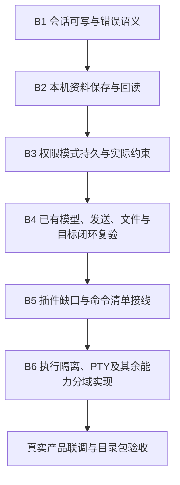

# 桌面前后端业务接通计划

## 1. 目标与执行边界

承接用户“打通前端后端，很多没有接入”的要求：停止只调整外观，按实际业务链验收。

本计划依据当前工作区源码、用户实际故障和私有宿主复验，不沿用 PRD 历史表里的“完整”作为当前结论。当前正在使用的目录包为底栏 v2；其 UI 298 项通过只能证明对应交互检查，不能证明所有按钮和全部能力可用。

本文件是大改前的实施方案。用户已确认先做 B1，随后明确要求以项目真实实现为主、停止反复测试与新增探针。B1 源码已实施并构建；默认 C 盘存储限制仍未解决，不登记完整可用。不提交、不发布、不替用户迁移数据，不改系统防护。临时 no-sandbox 入口沿用用户此前明确裁决，不因此放宽核心工具审批或执行隔离。

## 2. 统一完成标准

每一项必须贯穿：

- 保存成功必须发生在持久屏障成功之后；内存 append 不能叫“已保存”。
- 页面不得先改变状态再把失败请求留在后台；失败必须保留原值、草稿和可重试提示。
- 每项分别登记源码接线、实际宿主复验、真实页面验收、包内复验，不能合并成一个“通过”。
- 变化要验证坏参数、写入失败、版本冲突、重复请求、切会话后迟到结果、取消及重启。无副作用或不适用的场景明确说明，不凑空测试。
- 文件／进程执行仍走既有审批、观察版本与监督隔离；不得把 providerAvailable 从 false 硬改为 true。
- 没有后端的入口保持明确不可用，不能补一个永远成功的 mock。

## 3. 当前核实的入口状态

状态仅覆盖表内切片；“源码已接”不是本轮端到端 PASS。

| 可见入口／能力 | 当前事实 | 分类与证据 |
| --- | --- | --- |
| 会话列表、新建与切换 | `session-state.js → sessionCreate/Select → main.cjs → Host → SessionCatalog/WriteLease` 已接；C 盘实际路径失败被报为 already-owned | **接了但失败**。私有 C 盘无 lease 仍报 already-owned，D 盘同宿主可新建切换；见交付证据 §9.15 |
| 模型选择、供应商与自定义模型配置 | `model-directory-state.js` 与 `model-center-adapter.ts` 已调用 models/customs/binding 的具名通道，Host 已接共享注册表 | **源码已接，实际用户配置及起轮待专项核验**。不能因为缺省没有配置就判定无后端，也不能用页面存在判可用 |
| 2026-10-12 模型连接修复增量 | 两种HTTP客户端共用DLL／证书库对照确认缺SNI；生产流请求和模型清单已补齐，真实Host读取现有凭据成功拉取dgbmc11个／yapi32个模型 | **HTTPS与清单已实测**。自定义路由实际拒绝 `capability-unsatisfied`，手动模型能力元数据仍未知；生成／工具／取消尚未据此升级完成。前批ALPN根因及二次嵌套params结论作废，见交付证据§9.24 |
| 2026-10-12 自定义模型能力业务闭环 | 供应商能力编辑 → 严格IPC守卫 → 核心已有ModelSpec字段保存 → 路由全部要求校验 → 真实页面收到“接通成功。” | **隔离副本保存／取消／重启与真实文本流回复已实测**，见§9.25。用户原配置未代写，需在新版页面按实际能力确认。最终目录入口 `dist/electron/model-capabilities-final-20261012/win-unpacked/start-sacode-no-sandbox.cmd`；工具执行／取消／自动能力探测没有据此完成 |
| 发送、流式、停止、队列 | `send-queue-state.js` 经 userSend/taskStart/queue/turn 动词；task/start 只使用真实配置 | **源码已接，受会话存储及模型前提影响**。本轮不发收费请求、不读取用户凭据来凑验收 |
| 目标控制 | GoalBar 已用六个 goal 通道；Host 已有 `HostGoalRun → GoalRunner` 的显式 task/start 接线 | **源码已接，文案有过期描述**。不能用“自动跨轮未接通”文字代替实际驱动验证；恢复页面不得自动启动 |
| 文件树、搜索、读取、编辑保存前审查 | workspaceFiles/toolCall/approvalAsk/Answer 真实接线已存在 | **源码已接，读写与冲突需独立回归**。保存必须保留先读后写、精确审批与版本检查 |
| 2026-10-12 项目目录选择 | 项目菜单直接提供原生打开文件夹和最近目录；无路径编辑框、无defaultPath，用户未选项目时工作区为空 | **页面保存／最近切换／取消／重启与失效拒绝已实测**，见§9.26；应用D盘数据根不是用户项目。近期列表从会话事件回放，跨日志按mtime近似排序。最新入口 `dist/electron/project-picker-final-20261012/win-unpacked/start-sacode-no-sandbox.cmd` |
| Git 变更 | workspaceGitStatus/Diff 接 core 查询；页面明示只读 | **只读切片已接**；暂存／提交／推送／历史不是只需补按钮的功能，另外设计授权与恢复 |
| 终端 | 执行提案／授权／描述／输出／停止六动作已接；core `ExecutionApi.stateJson` 固定 providerAvailable=false，监督器默认未就绪 | **控制／回放切片有后端，实际执行受隔离门禁阻塞**；无交互 PTY，不可称完整终端 |
| 权限模式 | 两条 preload/IPC/Host 接线存在；前端把 `{ok,mode}` 当字符串，先更新本地再请求保存；Host set 仅 append | **接了但状态与持久化不成立**。私有宿主 set plan 后 EOF 正常退出，重启 get 仍为 build |
| 权限策略实际生效 | `PermissionPolicy` 和 `ModeController` 存在；当前搜索到 PermissionPolicy 的消费仅在测试，生产 ModelToolRuntime 仍按精确工单执行 | **未找到生产消费证据**。不能把模式字符串保存等价于权限策略生效，不能直接接入现有 yolo=allow 破坏审批约束 |
| 用户昵称／头像 | settings profile 明写持久化接口未接；preload 无 profile 读写动作，AccountMenu 显示固定“本地用户” | **缺后端服务和链路**；需要共享核心用户资料存储，不用 localStorage 冒充 |
| 外观、字号、输入偏好 | globalAppearance/globalSettings/tips 具名链路与用户存储已有 | **源码已接，受用户目录可写性影响**；需要重启、失败回滚和消费端复验 |
| 自启、快捷键自定义、通用数据导出 | 当前禁用或只说明未接，没有完整具名动作 | **缺后端／平台接口**。自启变更系统启动项，数据清理需单独确认范围 |
| 插件包本地安装／包启停／卸载 | plugins-ipc 与 Host 的 PluginStore 有实现 | **本地包切片已接**，不能扩称远端包、构建脚本审批及热装配完整 |
| 插件组件启停 | preload 和 IPC 转发存在，Host 直接回 plugin-entry-not-wired，initialize 却列该动作 | **声明存在、实现缺失**。私有当前包宿主已复现拒绝 |
| 插件安装取消 | preload 存在，plugins-ipc 直接抛 plugin-install-cancel-not-wired；本地安装当前为同步行为 | **实际取消未接**，需先定义异步状态与可取消阶段，不能把点击取消视为已停止 |
| ＋ 菜单计划、技能、MCP，斜杠命令 | 创建计划禁用，技能/MCP 清单未注入；review/compress/init 仅登记，app.js command 回调未执行它们 | **页面与声明不等于业务接通**；clear 只改投影显示也不是删除历史，须保留日志真源 |
| 语音、构建测试、安全扫描、部署、记忆等 | 语音按钮禁用；工作台资源清单多个项 available=false | **未接或缺完整后端**，逐域建设，不用解除 disabled 代替实现 |

### 本轮私有实测（未修改用户数据）

`apps/desktop/.tmp-test/takeover-20261011/integration-contracts-latest.json`：

1. 当前包 `approval/get-mode` 返回 `{ok:true,mode:"build"}`。
2. `approval/set-mode plan` 返回 `{ok:true,result:"committed"}`，同进程 get=plan。
3. 该时点没有 session.log 落盘，正常 EOF 退出（forced=false）。
4. 新宿主 get-mode=build，**重启丢失**。
5. `plugin/entry/set-enabled` 返回 `plugin-entry-not-wired`；能力表却声明该方法。

这不是完整全系统审计，不以该表计算产品完成率，也不把尚未实测的条目标为故障。

## 4. 单一接通主线（B1 已批准实施，其余按批推进）

### B1：先让会话基础可靠

- 区分租约真实冲突、持有者身份不明与文件 I/O 失败，Host 用明确失败数据、UI 用准确提示；保留已有占用码的兼容性，不把访问拒绝改成成功。
- 新建／选择失败必须保留当前会话及草稿，成功才更新选择；核 index 与 session 的写权释放及失败恢复。
- 找到 C 盘拒绝来源前不自动迁移到 D 盘。若需要改变会话存储根，先展示目标路径、说明现有数据保留方式，用户明确批准才迁移；不复制凭据、不抹掉旧数据。
- 验收：真实新建、选择、写入、持久化、重启恢复；另一个真实写者占用、不可写目录、旧日志损坏均正确拒绝且数据不变。

### B1 当前落地（本轮工作区）

- core WriteLease 增加稳定失败分类，进程判活为 alive/dead/unknown，访问拒绝与无效身份不当作死亡接管。
- Host 会话选择先核索引与目标写权；预检失败不释放原写权、不更新持久选择。新建、写入与选择回传准确存储失败；页面保留草稿并提示已创建但未打开的会话。
- 用户调整验证方向前首组宿主与页面状态20/20；之后停止新增探针、停止在跑的租约测试，保留该测试为人为中止未完成，不据此升级通过。
- 当前最终源码 Host 构建成功、目录版生成成功。仅运行一次实际入口就绪检查（非整套测试）：窗口、真实Host读取、侧栏底栏和正常退出成立。
- 当前目录版：`apps/desktop/dist/electron/business-b1-win-unpacked/start-sacode-no-sandbox.cmd`。不覆盖旧程序、不移动用户数据。
- **后续用户授权 D 盘落位**：新增真实主进程 `data-paths.cjs`，当前固定数据根 `D:\Project\sa\saai\sa-code\apps\desktop\data\sacode`；会话、用户配置、Electron 配置、缓存及临时文件分别落子目录。旧 C 盘数据未迁移、未删除；D 盘新数据链路已经实际新建与重启恢复。昵称已按 B2 接通，权限模式仍未实施，并发死亡持有者接管仍有独立竞态风险。

### B2：昵称先接真实保存，头像另核数据边界

- 核心提供独立本机资料服务，沿用统一用户根、写租约与原子发布；不混进外观文件破坏它的严格回放。
- 新增有限 profile/get、profile/update，经 Host、IPC、preload、资料页、底栏真实回读；字段校验和适用 revision 校验在核心收口。
- 昵称保存失败不显示新昵称；重启恢复、其他窗口重读、Unicode/长度/空白与损坏配置都有测试。
- 头像涉及文件选择、格式／大小与可访问性，按独立字段与资源引用处理，不接任意路径／URL，不冒充账号头像。

### B2 当前落地：昵称真实持久化（头像未开放）

- `core/src/user_profile.cj` 新增独立本机资料存储：`user/profile.log`，昵称 1–40 个 Unicode 字符，修订检查、写租约、完整草稿持久屏障后原子发布；损坏文件不按默认值覆盖。资料不进入会话或模型历史，不碰凭据文件。
- `apps/host/src/profile_surface.cj` 实际处理 `profile/get`、`profile/update`，能力协商已声明；失败按固定原因返回，不外泄原生异常或内部路径。
- `preload.cjs` 与 `main.cjs` 新增两个按动作命名的资料接口；IPC 顶层集合107→109，既有桥接清单同步更新，没有通用 request 通道。
- `settings-state.js` 个人资料替换占位，等待成功回执才更新底栏；`app.js` 与 AccountMenu 消费后端昵称。保存失败保留输入，窗口重新聚焦或打开资料页会重读，不冲掉未保存编辑。
- 实际新包资料页保存昵称、底栏同步、重启回读已完成，使用独立验证数据，不改变用户昵称。最终目录版默认 D 盘数据根读取成功，头像仍明确未开放。
- 当前入口：`apps/desktop/dist/electron/business-profile-win-unpacked/start-sacode-no-sandbox.cmd`。按用户要求未跑整套测试，仅编译、语法检查、构建与实际页面业务确认。

### B3：权限不是一个只会换文字的选择器

- 先修真实回复结构、等待保存成功后回显、错误保留旧值、取消与卸载监听。
- Host 写模式前持有会话写权、完成持久屏障再返回 committed；失败不得留下可继续使用的未确认模式。
- 工具执行消费模式：Plan 拒绝副作用等约束必须在共享 core 的实际派发前生效，手工工具和模型路径一致；后端拒绝不可被 UI 撤销。
- **Build/Auto/Yolo 的授权映射需先裁决**：本仓既定精确一次性审批不能因“打通”被自动取消；不直接使用字符串前缀白名单授权命令，不自动批准执行／工作树删除。默认继续 fail-closed。
- 验收：点击→回读→重启，及真实被拒工具没有副作用；只保存枚举不算本批完成。

### B4–B6：依赖第一条主线，不在首批堆功能

- B4 复验已有真实模型／发送／停止／队列／附件／读写文件／Goal 边界链，修过期文案；本地受控 provider 与远端真实调用证据分别登记，收费请求及外部写操作另确认。
- B5 先整理能力协商与 stub：组件启停必须有 core 装配状态，取消必须有真实异步生命周期；命令清单只开放有实际执行面的命令，其他项明确不可用而不是点了没反应。
- B6 执行监督／隔离通过后才开放命令执行；PTY、自动化、语音、知识、数据库、远程与扫描按 PRD 逐域实施，不将“全部打通”压成一次无边界改动。

## 5. 交付与确认门槛

- 每批先列失败场景并跑红，再改、重建对应 Host/vendor，过针对性与业务真实入口测试。
- 不用已有 GUI 大套件的绿色代替新业务链验收；用户实际默认路径的权限前提单独验证。
- 改 IPC 同步更新 preload 与 `test/bridge.test.mjs`，重新核有限顶层集合，不开放任意 request 通道。
- 每批给一份新目录包，不覆盖用户正在运行的程序；清楚指出哪些能力已经可用、哪些仍 BLOCKED。
- 推荐先批准 **B1**，把会话可写性与错误语义收口后再进入 B2。系统权限归因仍待证据；实施 B1 不授权修改系统防护／用户目录 ACL。
