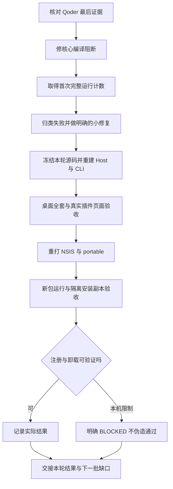
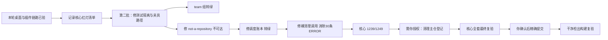

# 接手回归修复与插件、新包验收（2026-10-11）

> 状态：桌面功能链与新包运行验收已完成；核心最终复验尚待汇总。布局完整专项因驱动期限超时未完成，安装登记、自卸载与普通启动专项没有通过证据，不能称整体交付完成。
> **2026-10-12 更正**：§9.22／§9.23 关于“ALPN 根因”“供应商不兼容”“必须换供应商”以及“自定义模型参数要二次嵌套 params”的结论均已被同配置实验推翻，勿作为现行排障依据。当前准确结论和范围见 §9.24：缺 SNI；两家已有密钥实际拉取模型清单成功，自定义路由另被未知能力元数据拒绝。
> 范围：接手 Qoder 剩余的「修复完整套件剩余功能链失败」「验收插件管理页及新安装包」。用户随后裁决先收口这两项，较大的调度持久化和工作树问题另批处理。
> 本轮不提交、不发布，不覆盖用户既有应用。用户另行允许在专用测试目录中进行安装、注册查询与自带卸载器验收。

## 1. 唯一主线



## 2. 输入与取证边界

- 接手时 HEAD 为 `40b3ffb`，工作区已有大量修改与未跟踪实现，未代他线提交。
- 期间 HEAD 前进到 `d3dd02c`（只有 Qoder 的 §44 证据提交）；本助手未执行 git add/commit/push。最终源码快照注明该 HEAD，不误称一直固定在接手 SHA。
- 实施前读取总体方案、能力矩阵及 P0 状态；当前范围按 PRD，不将旧复刻百分比或历史 PASS 换算为本轮产品完成。
- 最新 Qoder §44 仅留下核心测试编译 5 条错误；本轮真正运行后才发现后续两条 mutable capture 编译错误以及运行级红灯。静态审计不能替代这些实测。
- 所有日志、探针、私有包和隔离安装副本均在 `apps/desktop/.tmp-test/takeover-20261011/`；日志可能包含 UTF-16 的 PowerShell 重定向版本及 UTF-8 的 Node 驱动版本。凭据不进入报告。
- 运行真实模型时只从用户既有凭据文件读入测试进程环境，不打印、不另存密钥；保留真实网络失败，不降低 TLS 校验。

## 3. 本轮代码修复与影响

| 文件 | 改动与原因 | 影响边界 |
| --- | --- | --- |
| `core/src/cmds.cj`、`agent.cj`、`cmds_test.cj` | 将内置命令登记统一为包级入口；注册允许传解析器；解析 review 的 target、effort、comment/fix/resume；修 lambda 参数与 size 属性语法，补非法参数断言 | 只证明登记和解析，review/compress/init 仍是执行骨架，不冒称完整斜杠功能 |
| `core/src/acp_approval_test.cj` | 假钟装入不可变对象引用，消除逃逸闭包捕获 mutable 局部变量；补一次性批准消费断言 | 保留过期/拒绝/重复答复语义 |
| `core/src/worktree_setup_test.cj` | 超长名称先冻结不可变字符串，再交给闭包 | 保留原拒绝断言 |
| `core/src/acp_approval_bridge.cj` | 人工批准先写入 desk，再精确消费；原实现直接消费 pending 工单，导致批准永远不成立 | 不放宽工具名、提案绑定或一次性约束 |
| `core/src/acp_delegation.cj`、`acp_delegation_test.cj` | 幂等摘要改用已有 SHA256；原 Int64 滚动乘法溢出，使长任务错误不是稳定冲突 | 不添加依赖，不将委派入口缺口算作完成 |
| `core/src/model_agent.cj` | 保留 `ApprovalOutcome.structured` 对象失败，不二次转义；LSP 只读与重命名预览不作为 Goal 进展计数 | 不改变一般工具调用的成功结算 |
| `core/src/agent.cj` | 空路径代表有效工作目录时提前返回，避免 `Path("").isAbsolute()` 抛错 | 作用于 glob/grep/shell 等目录查询，未放宽非空路径权限 |
| `core/src/team_workspace_test.cj` | 夹具不依赖未自建的固定父目录，使用本轮 TMP 的原子唯一目录 | 不修生产隔离实现，不把本机残留作为前提 |
| `core/src/fs_tools_test.cj` | 修正 `?` 单字符及 `*` 不跨目录的错断言，补正确正向示例 | 未改变 glob 产品匹配规则 |
| `core/src/web_search.cj` | Tinyfish 既有 GET 分支返回空正文而非 `{}` | 未改外部服务地址或权限 |
| `core/src/worktree.cj`、`worktree_test.cj` | Windows 保留的 agent- 前缀忽略大小写；随机名断言只检查末段而非整名 | 保留目录清理边界，未替剩余工作树问题背书 |
| `extjs/test/extjs.test.mjs` | 协议测试改用相对路径，异常断言对齐脱敏契约；补绝对/穿越路径拒绝与失败后的自有子进程清理 | 不放宽产品加载白名单，不打印插件原始异常 |

### 3.1 第二至五批新增改动（测试隔离与核心缺口）

| 文件 | 改动与原因 | 影响边界 |
| --- | --- | --- |
| `core/src/test_fixture_path.cj`（新增） | 夹具唯一落位 `coreTestRoot()` / `coreTestDir()` / `coreTestDirCreated()`；刻意不做模块级可变缓存 | 只提供路径，不改任何产品行为 |
| `core/src/team_runner_test.cj` | 夹具改用 TMP 原子建目录（原写死 `D:/…/target`），清理改为尽力而为 | 修夹具路径缺陷；**不代表 `teamRunnerClaims` 异常路径释放逻辑被证明正确** |
| `core/src/execution_{api,output,service,supervisor}_test.cj` | 18 处跨模块硬编码路径（原指向 `apps/desktop/.tmp-test/…`）改用 TMP | 消除「干净检出必然失败」的一批 |
| `core/src/computer_provider_test.cj` | 夹具源码与工作目录改按包内相对路径解析 | 消除换机即失效的绝对路径 |
| `core/src/worktree_test.cj` | 新增 `wtInertGitBoundary`（写 `.git` **文件**截断向上发现）、夹具落私有根 | 修夹具隔离；不改 worktree 产品逻辑 |
| `core/src/worktree.cj` | 新增 `wtGitRepositoryProbe` + `wtIsNotARepositoryDiagnostic`：git 明确说非仓库时翻成 `worktree-not-a-repository` | **对外错误码变更**：该码此前对真实非仓库目录不可达；超时/流损坏/其它非零仍走 `worktree-git-failed` |
| `core/src/schedule.cj` | `TaskDefinition` 增补完整构造（字段改 `var` 以支持重复注册刷新 revision）；新增 `defineTask` / `applyTaskDef` / `scheduleSplitAll`；回放补 `taskpause`/`taskresume`/`taskdelete`；`deleteTask` 改真删除；`pause`/`resume` 同步两份状态 | 调度账本字段与回放；`delete` 后 `list` 不再含该项（符合计划 Task 3） |
| `core/src/worktree_tools_test.cj` | 新增 `wtToolsTidy`（try/catch 包裹），30 处裸 `removeIfExists` 全改 | 清理失败不再把绿用例变成 ERROR；不掩盖产品行为 |
| `core/src/{team_workspace,worktree_setup,worktree_tools,batch,team_runner}_test.cj` | 夹具落点统一到 `coreTestRoot()`，不再在 TMP 根散落 | 残留集中便于清理 |
| `core/src/schedule_test.cj` | 6 处夹具根改用 `coreTestDirCreated`，删掉冗余的 `removeIfExists`+`Directory.create` | 修一处仓库红线违规（夹具曾直接建在 `core/` 源码树） |

## 4. 回归记录（逐轮保留，不拼读数）

| 批次 | 真实结果 | 判定 |
| --- | --- | --- |
| 桌面首轮默认并发 | 674 tests / 661 pass / 5 fail / 8 skipped / rc=1 | 三条 OpenSSL 工具缺失；两条团队超时/文件锁，不能算全套通过 |
| OpenSSL 与团队专项 | 7/7，0 skipped，rc=0 | 设置既有 `SACODE_OPENSSL`，没有改产品守卫 |
| 桌面串行带凭据第一轮 | 674 / 670 pass / 2 fail / 2 skipped / rc=1 | 团队仍超时；两条 startup 未显式设置 SACODE_HOST 而跳过 |
| 新 Host 桌面串行第二轮 | 674 / 672 pass / 2 fail / 0 skipped / rc=1 | 团队已过；两条真实远端回合中断，日志是 `http-request-error` |
| 原断言远端+团队复验 | 5/5，0 fail / 0 skipped / rc=0 | 不能拿专项覆盖上一轮全套失败 |
| 扩展宿主最终全套 | 73/73，0 fail / 0 skipped / rc=0 | 增加安全拒绝断言后仍全绿 |
| 核心首次完整运行 | TOTAL 1249 / PASSED 1185 / FAILED 20 / ERROR 42 / SKIPPED 2 / rc=1 | 首次真实计数，不是产品通过 |
| 核心小修复后完整运行 | TOTAL 1249 / PASSED 1204 / FAILED 9 / ERROR 34 / SKIPPED 2 / rc=1 | 未通过项减少 19，全库仍红。其后空路径修复与两条强化断言需按最终源码复验 |
| **核心第三轮源码完整运行** | TOTAL 1249 / PASSED 1203 / FAILED 9 / ERROR 35 / SKIPPED 2 / rc=1 | 全库仍红；比上轮少 1 条通过，本轮收尾改动无净收益，见 §7.3 |
| **核心第四轮（修调度账本 + 夹具落点）** | TOTAL 1249 / PASSED 1208 / FAILED 6 / ERROR 33 / SKIPPED 2 / rc=1 | 净增 5 条，零回归；发现 39 条里 30 条同源于裸 `removeIfExists`，见 §9.4 |
| **核心第五轮（修裸清理调用）** | TOTAL 1249 / **PASSED 1239** / FAILED 6 / ERROR 2 / SKIPPED 2 / rc=1 | **净增 31 条，零回归**；30 条清理 ERROR 一次性消除，见 §9.6 |
| 页面资源构建 | `npm run vendor` rc=0 | 构建期经典脚本和 CSP 自检通过，不等于 TypeScript 全量类型检查 |
| 静态检查 | `node --check` 与限定文件 `git diff --check` rc=0；cjlint 工具 rc=0，但全库有 2816 suggestions / 398 mandatory | 不把 lint 工具 rc=0 写成零问题；项目无 lint/typecheck npm 脚本与 TypeScript 编译器，不安装依赖凑读数 |
| IPC 实际集合 | preload 107 / 注册 107，重复与双向差集为空 | 旧静态门禁只数 main.cjs，漏拆分模块，仍需下一批升级 |

## 5. 安装与卸载的边界取证

用户允许专用测试目录安装与卸载，不允许覆盖既有应用或改默认 Programs 安装。执行前核当前/机器、32/64 位注册项与快捷方式，存在即停止。

1. 旧包与私有诊断包都能解出 167/168 个文件并返回 0，但没有登记与快捷方式。
2. 私有诊断宏证明 `customInstall`（在 `registryAddInstallInfo` 之后）确实执行，安装模式 `CurrentUser`，真实 GUID 是 `610e7fc6-8cb1-592d-a92a-d7b289ba1573`。旧 Qoder 手算的 `e56f...` 不能作为本轮唯一搜索键；本轮两者与两种注册表视图均核对。
3. 同一安装进程直接 `WriteRegStr HKCU` 临时诊断值也返回失败，随后只清本轮临时诊断子键。证据指向本发起链不能写 HKCU；不能把注册缺失直接归罪产品模板，亦没有定位具体拦截方。
4. PowerShell 脚本签名策略首次挡住测试驱动，未修改执行策略、未提权；后续 Node 驱动启动安装器，未绕过注册写限制。
5. 自带卸载器 rc=0，167→167，不能用退出码冒充真正删除。失败安装副本在运行验证后按精确路径清理，只处理本轮新建目录。
6. 当前注册登记与真正自卸载仍为 **BLOCKED/未通过**。解锁需用户在正常交互链路配合安装与卸载，或定位本机策略；不得手工补注册后称安装成功。

## 6. 新产物运行验收（第一轮，不覆盖最终源码）

- 第一轮新包 13:00 产出；源/`win-unpacked`/NSIS 实装副本的 Host SHA256 均为 `c58e5800d0addb1a434e5ef83c9cf37f475e52e675ef377ef7ba6be7eee2925a`。
- portable、win-unpacked 复跑、实际安装副本均有本轮报告：296 checks / failed=0 / passed=true / packaged=true。
- 首轮 win-unpacked 曾出现「增强在途时仍能切到另一个会话」1 条失败；保留该事实，不用后续绿报告擦除。
- 16 条插件相关检查全部通过，含真实页面本地安装、启停落盘与回读、取消卸载确认、确认卸载、刷新清单及槽位装卸生命周期。
- 普通启动专项 `check-desktop-startup.mjs` 报主进程 rc=2147483651、validated=false；不能由 --ui-smoke 全绿推出普通启动已验。该专项的 Inspector/环境是否影响尚未定位，单列待核。
- Setup、portable、SaCode.exe 签名均 NotSigned。
- 第一轮包不含其后核心小修复，最终源码交付正在重建，以下结果不得凭这轮数据预填。
- 普通启动专项使用 Inspector 调试入口，并非纯双击启动；其 rc=2147483651 仅证明该专项失败，不足以定罪正常产品启动。未获得可见窗口证据前保留未验证。
- 随后以最终包做私有单变量对照：保留原脚本的可见窗口、Host 请求、页面就绪断言，只在驱动增加 `--no-sandbox`，结果 rc=0、`STARTUP_PASS {"visible":true,"hostReady":true,"ready":"complete","controls":105,"bodyLength":130}`。这证明该条件下普通业务入口可以运行，不能外推默认 sandbox 条件已通过。没有修改产品配置或默认启动参数，未取消应用内 IPC、审批和凭据守卫。默认普通启动继续记未验证，具体环境根因待核。

## 7. 最终源码交付

最终驱动已完成：Host build / CLI build / pack-host / electron-builder 四步均 rc=0。新 Host 13:21:46、11,165,696 B；Setup 13:23:35、93,347,518 B；portable 13:23:49、93,195,486 B，均为本轮实际新产物。该轮源码输入快照登记 705 个源码/配置文件，不含凭据或用户数据；源码状态仍是工作区态而非固定提交。

最终串行驱动已取得以下报告，全部针对本轮新产物，不借前一轮读数：

| 项 | 最终实测 | 判定 |
| --- | --- | --- |
| 桌面完整套件（串行、带真实凭据、显式 SACODE_HOST） | tests=674 / pass=674 / fail=0 / cancelled=0 / skipped=0 / rc=0 | PASS，仅限本轮命令与工作区/产物前提 |
| win-unpacked `--ui-smoke` | 296 checks / failed=0 / passed=true / packaged=true / rc=0 | PASS |
| portable `--ui-smoke` | 296 checks / failed=0 / passed=true / packaged=true / rc=0 | PASS，依据报告而非启动器空 stdout |
| NSIS 隔离实际安装副本 `--ui-smoke` | 296 checks / failed=0 / passed=true / packaged=true / rc=0 | 运行 PASS，不代表注册与卸载 PASS |
| 插件页面与生命周期 | 上述三面各 16 条插件相关检查全绿，含真实本地安装、启停、回读、确认卸载和槽位撤销 | PASS，不含远程市场与 entry 开关等既有缺口 |
| 剥 SDK PATH 的 CLI 最终复验 | all 132、stream 21、tool 16、ext 8、cancel 9、extjs 12、headless 36、att 23、goal 10、plugin 17，各 rc=0 / fail=0 | PASS；各组重叠，禁止相加成独立用例总数 |
| NSIS 注册与快捷方式 | 167 文件存在，注册/快捷方式仍空 | 未通过，结合私有诊断记本发起链环境 BLOCKED |
| 自带卸载器 | rc=0，但 167→167，应用文件仍在 | 未通过，不能用退出码结算成功 |
| 本轮安装副本清理 | Node 驱动首次 EBUSY；核无本轮活跃应用进程后，精确路径清理成功 | 清理完成；不是自带卸载器通过 |

最终 Host 三面 SHA256 完全相同：`6e5b5ca2a4928faab788763a9b43508f56788fbd3606c5d329fceab990f333c2`（源 `dist/host/bin`、win-unpacked 随包宿主、NSIS 实装宿主）。完整产物摘要、字节数、mtime 在任务目录 `delivery-artifacts.json`，三面哈希在 `delivery-host-hashes.json`。本轮只核这三腿，不用 portable UI 报告替代 portable 内部文件哈希。

**随后补齐第四腿（实际解包，不覆盖上述时点）**：使用构建器已有缓存里的 7za（无需安装）从最终 portable 解出 `resources/host/bin/sacode-host.exe` 与 `resources/app.asar` 到本轮私有目录，解包 rc=0（自解压 exe 的尾部数据提示属于格式提示，未忽略解包失败）。portable 宿主 SHA256 同为 `6e5b5ca2a4928faab788763a9b43508f56788fbd3606c5d329fceab990f333c2`，于是四面宿主一致；portable 与 win-unpacked 的 `app.asar` 同为 `bce2af20ffc83dd9c4e8fca70cb89eb106fb19a392ef86ffff7c8fb7ee13839c`。解出的两文件在任务目录 `portable-payload-check/`，不入库。

**归档内容按实际字节核对（PASS）**：`asar-input-check.cjs` 用 `@electron/asar` 的 `listPackage` 列出包内条目（共 197 项），再 `extractFile` 与工作区逐字节比对。18 个关键文件全部 `present=true` 且 `matchesSource=true`：10 个主进程与桥接模块（含 team/worktree/execution/models/customs/plugins/lsp 七个拆分 IPC）、`renderer/app.js`、4 个页面折叠产物（plugin-manager、plugins-page、composer-attachments、tinyrobot）、Vue runtime、以及 layout 与 ui-smoke 脚本。同时扫描包内条目，`.tmp-test` 目录、`debug.log`、`credentials.env`、`step.key` **命中 0**。结论：包内渲染层产物确由本轮工作区字节构建而来，且未夹带临时产物或凭据材料。

> 探针自身经历一次误判并已更正：首版把 asar 在 Windows 返回的 `\renderer\vendor\...` 规范化得不够干净，误报 `plugin-manager.iife.js was not found`，我当时按未完成登记；随后 `listPackage` 直接列出该条目，确认是探针错误而非缺文件。`extractFile` 在 Windows 上按 `path.sep` 拆目录，必须传反斜杠形式，正斜杠也会误报不存在。两次误报都记在案，不当成产品缺陷。

最终串行驱动曾在清理失败时退出，故后续 CLI 和总体 JSON 未执行。CLI 已单独补验并成功；驱动补了有界清理重试与逐步骤写汇总，不重跑安装伪装原驱动 rc=0。该次总驱动 rc=1 与桌面全套 rc=0 分开记录。

独立汇总 `delivery-summary.json` 已从原始报告生成，明确 `overallPassed=false`。705 个构建输入在最终验收后再校验，`changed=[]`。这证明本轮工作区输入未变化，不证明未入库依赖已成为干净提交可复现。

### 7.1 最终包布局专项：部分已验，完整未完成

- 私有驱动 `layout-acceptance.cjs` 对真实 win-unpacked 执行 `--layout-smoke --no-sandbox`，上层期限 240000ms；结果 `spawnSync ETIMEDOUT`、驱动 rc=1。
- 日志持续出现 `LAYOUT PASS`，截至结束已执行 light 的 860×600、880×640、1100×720；中间报告 64 组 / failedGroups=0。截图和报告不能证明尚未执行的 dark 或 1440×900。
- 报告是在流程中间更新（非完整尾部报告）。产品脚本设计范围为两主题×四视口，不能拿“64 组无失败”宣称 192 组全量通过。
- 当前迹象为完整脚本持续推进而驱动总时限不足；未定位到卡死断言，不定罪为产品界面缺陷。按本轮收口裁决不放宽断言、不直接延长超时重跑，完整布局专项保留未验证。
- 超时后核进程：无 SaCode / sacode-host 残留，未终止其他进程。
- 用户继续要求推进后，按前轮每视口约 75 秒的持续执行读数，为八视口完整工作量配置 900000ms（15 分钟）总预算，重新使用 `layout-complete-recheck` 空目录运行。产品断言、单项等待和视口范围一字未改；新增汇总要求两主题四视口均有报告且完整 192 组，未完成不得报通过。

### 7.2 布局完整专项：最终通过

| 项 | 实测 |
| --- | --- |
| 入口 | 最终 win-unpacked `SaCode.exe`，`--layout-smoke --no-sandbox`，全新会话与截图目录 |
| 总预算 | 900000ms（按上轮持续推进读数配置，未改任何产品断言或单项等待） |
| 报告 | groups=192 / failedGroups=0 / complete=true / rc=0 |
| 覆盖 | light 与 dark × 860×600、880×640、1100×720、1440×900，每组合 24 组，八组合齐全 |
| 汇总文件 | `layout-complete-recheck-summary.json`（本轮私有目录，不入库） |

旧 240 秒超时记录保留在案，不因本次通过而删除。该项此前记为「部分已验、完整未验」，现更正为**完整布局专项 PASS**（仅限两主题四视口这一既定范围，真实窗口几何与截图，未新增视口或主题）。

### 7.3 核心第三轮完整运行（历史读数，已被后续取代）

> 本节是**当时的原始读数，保留不删**；该读数已被 §9.6 的第五轮取代（PASSED 1203 → 1239）。此处不因后续转绿而改写。

当轮源码（含本轮全部收尾改动，空路径修复、ACP 与 LSP 修正、命令登记与解析）重编译完整执行：

| 项 | 实测 |
| --- | --- |
| 汇总 | TOTAL=1249 / PASSED=1203 / FAILED=9 / ERROR=35 / SKIPPED=2 / rc=1 |
| 对比上一轮 | 通过 1204 → 1203、错误 34 → 35。**本轮收尾改动没有净收益**，如实记录，不当作改进 |
| 失败清单 | `core-failures-final2.json`（44 条，逐条含 FAILED/ERROR 与用例名） |

按模块归类：worktree 系 12、team 系 3、schedule 系 3、其余 26。取证要点：

- **team 系 `team-runner-session-owned` 2 条**：初判为 `teamRunnerClaims` 全局认领在异常路径不归还（并发状态未清），**该判断是错的**。真实根因在夹具：`TeamRunnerFixture` 硬编码 `D:/Project/sa/saai/sa-code/target`，而本轮 TMP 已指向私有目录、该路径不存在，夹具在 `init` 就抛 `fixture-lease`，`finally` 根本没执行，全局认领自然不归还。**夹具路径缺陷伪装成了并发缺陷**，后续用例被连带误报。见 §9.1 的实测修复与复验。
- **worktree 系多数为夹具清理 `Failed to remove … Access is denied`**：Git 只读对象在本机不可删，叠加仓内非 Git 夹具向上发现主仓的问题。与 §8 记录一致。
- **schedule 系 3 条**（当轮读数）、**浏览器 1 条**（Chrome 普通用户档案受限）仍按原判定留在下一批。schedule 3 条已在 §9.3 修复并复验通过。

本轮不对这些做修复，也不因「桌面全套 674/674 与三面 UI 全绿」推断核心全绿——两者是不同测试面，读数不可互相替代。

补充验证误操作：我在仓库根执行了一次 `cjpm test --skip-build --filter='*command*'`，它转入 workspace 各成员，过滤不到的集合出现全跳过并 rc=1，不是任何功能通过证据。已纠正为 core 工作目录、完整过滤 `*` 并重编译执行最终源码。该命令未修改产品源码，不把全跳过当绿灯。

本轮不以旧包顶替，不新增功能范围，不处理用户既有安装。

## 8. 下一批核心缺口

- 调度定义字段未实际进入 TaskDefinition；删除仅设 inactive 仍出现在清单；火次和任务事件回放需按持久化契约完整设计，不只补一条断言。**根因已定位并修复，见 §9.3**。
- 工作树夹具清理 Git 只读对象时报访问拒绝；仓内非 Git 夹具会向上发现主仓，需要固定 Git 搜索边界；还有 PR 解析、失败不留目录、代理终结等契约差异。
- `git worktree list` 在本轮读数里出现主仓 `.sacode/worktrees/alpha` 与两条 agent 工作树登记，与“非 Git”夹具向上发现主仓的风险一致。尚未对登记的创建归属逐条取证，未删除目录或修改 Git 引用；需下一批核归属后精确清理，禁止 broad reset/prune。
- 团队持久化失败注入用“超 4096”假定失败，但 batched 屏障本来支持分块，应改为真实故障注入；成员 session-owned 错误需核资源释放。
- Chrome 普通用户档案受限；应核私有绝对 user-data-dir 与清理，不碰用户 Chrome 档案。
- 核心真实模型两条仍跳过，既有 endpoint 和凭据前提须单独验证，不能拿桌面真实网络专项代替。
- 本轮不提供整体完成率，也不称干净提交可复现，当前仍是未提交工作区态。

### 9.1 第二批：测试隔离与全局状态归还（进行中）

用户批准推进「先修测试隔离与全局状态归还」。范围只限验证基础，不碰调度回放等业务缺口。

**根因更正**：§7.3 曾把 team 两条红灯判为「`teamRunnerClaims` 全局认领在异常路径不归还的并发缺陷」。实测证明这是错的——`TeamRunnerFixture` 硬编码 `D:/Project/sa/saai/sa-code/target`，TMP 改指私有目录后该路径不存在，夹具 `init` 抛 `fixture-lease`，`finally` 从未执行，认领自然不归还。**夹具缺陷伪装成并发缺陷**，我上一轮的判断偏了。

| 改动 | 位置 | 目的 |
| --- | --- | --- |
| 新增夹具路径入口 `coreTestRoot` / `coreTestDir` | `core/src/test_fixture_path.cj`（新增） | 产物只落 TMP 下私有根目录，与「测试目录只落已忽略位置」对齐 |
| `TeamRunnerFixture` 改用 TMP 原子建目录 + 尽力清理 | `core/src/team_runner_test.cj` | 修复 2 条 team 红灯的真正根因 |
| execution 系 18 处跨模块硬编码路径改用 TMP | `execution_{api,output,service,supervisor}_test.cj` | 原先写死 `apps/desktop/.tmp-test/host-restore-20261009/…`，跨模块且干净检出必红 |
| `computer_provider_test` 改按包内相对路径解析 | `core/src/computer_provider_test.cj` | 消除换机即失效的绝对路径 |
| 新增 `wtInertGitBoundary`，worktree 夹具改落私有根 | `core/src/worktree_test.cj` | 切断非 Git 夹具向上发现主仓 |
| 清理本轮 TMP 下 211 个残留夹具目录（193 个含 `.git`） | 私有目录，不入库 | 这是 `Access is denied` 清理失败的来源 |

**core 单测硬编码绝对路径：19 → 0**（`grep` 复核）。编译 `cjpm test --no-run` rc=0。

**实测复验**：`cjpm test --filter='*teamRunner*'` 在 `core/` 目录执行 → TOTAL 1249 / PASSED 6 / SKIPPED 1243 / FAILED 0 / ERROR 0，**rc=0**。两条原 ERROR 的 `teamRunnerConcurrentMembersCancelOnlyOneAndPersistSettlement` 与 `teamRunnerCloseTimeoutRetainsLeaseUntilActualJoin` 均通过。

`cjpm test --filter='*wtCore*'` → TOTAL 1249 / **PASSED 27** / SKIPPED 1216 / FAILED 4 / ERROR 2，rc=1。对照上轮该组读数，**通过数上升、无新增回归**：余下 6 条上轮即为红。其中 `wtCoreRejectsOutsideRepository` 的失败码从上轮的 `worktree-name-taken` 变为 `worktree-git-failed`——**这恰好证明隔离修复生效**：夹具不再命中主仓被占用的 `alpha`。但它同时暴露一个真实产品缺口，见下。

#### 隔离修复顺带暴露的产品缺口（已修并复验）

`wtRepoRoots`（`core/src/worktree.cj`）原先有一处 `wtFail("worktree-not-a-repository")`，但**对任何真实的非仓库目录都不可达**：它先跑 `git rev-parse --show-toplevel`，非仓库里 git 直接以 rc=128 退出，于是先被 `wtGitText` 判成 `worktree-git-failed`，走不到那行。两条独立探针复核：

| 场景 | 命令 | rc | git 输出 |
| --- | --- | --- | --- |
| `.git` 文件边界（私有目录） | `rev-parse --show-toplevel` | 128 | `fatal: not a git repository: /nonexistent-xyz` |
| **真实系统 TEMP 的非仓库目录** | `rev-parse --show-toplevel` | 128 | `fatal: not a git repository (or any of the parent directories): .git` |

两条都指向同一结论：**该测试断言的 `worktree-not-a-repository` 从引入起（与 `worktree.cj` 同一提交 `90f3e23`）就不可能通过**，不是本轮回归。

**修的是产品，不是断言**。依据是同文件内的对称设计：兄弟用例 `wtCoreRejectsWhenNoDirectoryIsKnown` 对自己的前提断言领域码 `worktree-no-directory`；同一份稳定错误码闭集里既然有 `worktree-not-a-repository`，就应当真的能吐出来。若反过来把断言改成迁就 `worktree-git-failed`，等于把缺陷固化成契约。

改动（`core/src/worktree.cj`）：

- 新增 `wtGitRepositoryProbe`：第一个 `rev-parse --show-toplevel` 专用。仅当 git 明确说「这里没有仓库」时翻成 `worktree-not-a-repository`；超时、流损坏、其它非零仍走 `worktree-git-failed` 并保留 detail。分工不变，但错误码从此真的稳定。
- 新增 `wtIsNotARepositoryDiagnostic`：只认稳定片段 `not a git repository`，不做整句匹配（git 措辞会随版本与场景变，且存在上述两种变体）。
- 第 799 行那处 `wtGitText(... "--show-toplevel")` **未改**：它只在「磁盘上已有同名工作树目录」的复用分支运行，目录必属仓库，用 `wtGitText` 才对。

**复验**：`cjpm test --filter='*wtCoreRejectsOutsideRepository*'` → PASSED 1 / FAILED 0 / ERROR 0，**rc=0**。

#### 顺带清掉一处仓库红线违规

`schedule_test.cj` 原先把夹具建成**当前工作目录下的相对路径**（`let root = "core-sched-due"`），即直接在 `core/` 源码树里建目录；用例中途抛错时末尾的 `removeIfExists` 不执行，目录就留在那里——实测已残留 `core/core-sched-due`（空目录，故不出现在 `git status`，但仍是源码树里的游离物）。已按精确路径删除，并把 6 处夹具根改用 `coreTestDirCreated`，同时删掉因此冗余的 `removeIfExists` + `Directory.create` 两行。

**复验**：`cjpm test --filter='*schedule*'` → PASSED 9 / FAILED 2 / ERROR 1，rc=1。**与上轮是同一批 3 条**（`scheduleTaskRegisterPersistsDefinition`、`scheduleTaskDeleteRemovesFromList`、`scheduleDueTasksReturnsOnlyActiveWithoutPending`）——本轮只改夹具落位、没动业务逻辑，所以这三条既未新增也未修复，属预期。源码树残留 0，夹具正确落到被忽略的私有根，这正是本轮要验证的部分。

#### worktree 组余下 6 条的真实原因（非本批引入，上轮即红）

| 用例 | 实测原因 |
| --- | --- |
| `wtCoreVanishedDirectoryClearsBindingAndContinues` | ERROR `worktree-branch-taken` |
| `wtCoreRemoveRequiresCreatingSession` | ERROR `worktree-not-active` |
| `wtCoreCreateFailureLeavesNoDirectory` | 断言 `.sacode` 应不存在但为真；stderr 显示 `worktree-branch-taken: worktree-taken` |
| `wtCorePullRequestReferenceParsing` | 断言错误码不符 |
| `wtCoreAgentPrepareFinishLifecycle` | 断言 `worktree-agent-unknown` 不符 |

其中 3 条的 stderr 出现 `worktree-branch-taken: worktree-taken`，与主仓残留的 `worktree-alpha` / `worktree-agent-*` 分支同源——**主仓登记未清前，这批用例的读数仍可能被残留污染**。这加强了「先精确清理主仓登记」这一步的必要性。

#### 本批的三处自身失误（如实留痕）

1. **批量正则改代码打坏了语法**：用 PowerShell 批量替换路径时，多行被截断成 `"${coreTestDir("x")}.log;`。连续三轮「补一个、修三个」后我停手，改为写脚本**按显式表格整行重建**才收敛。此后不再用内联正则批量改仓颉源码。
2. **`clean-fixture-leftovers.cjs` 的 `--dry-run` 写反**：条件写成 `includes('--apply')`，导致「预览」实际执行了删除。结果是 211 个全部删成功、0 失败，与本意一致，但开关名不副实，已改正。
3. **`wtInertGitBoundary` 首版注释与事实相反**：我先写「空 `.git` 目录能截断向上发现」，私有探针实测 `git rev-parse --show-toplevel` 仍返回主仓、rc=0；改写成 `.git` **文件**（`gitdir: /nonexistent-xyz`）才 rc=128 就地失败、不再向上。注释已按实测改写，并标为「不要照着直觉改成目录」。

#### 主仓工作树登记：已取证，未删除

`git worktree list` 中的 `.sacode/worktrees/alpha` 与三条 `agent-*`，**已确认是测试运行写进主仓的残留**，不是用户工作：

- 四个目录 `git status --porcelain` 均为**空**（无未提交内容），HEAD 全为 `d3dd02c`（与主仓同一提交）。
- `alpha` 正是 `wtCoreRejectsOutsideRepository` 用例传入的字面名；该用例上一轮的实测失败码是 `worktree-name-taken` 而非 `worktree-not-a-repository`，**因为 `alpha` 已被上一轮自己创建并占用**——失败原因就是隔离缺失，不是 slug 校验。
- 对应分支 `worktree-alpha`、`worktree-agent-*` 同样残留。

**按约定未删除**：虽已取证，但删除会改写主仓 Git 登记，且用户未授权本批做清理动作。留下一条明确建议：由用户确认后，用 `git worktree remove` + 删对应分支**逐条精确**处理，禁止 broad `reset`/`prune`。在此之前，任何跑到 `wtCoreRejectsOutsideRepository` 的复验都会继续命中 `worktree-name-taken`——这一点在清理前必须先知道。

### 9.3 调度账本：字段丢失与回放缺失（已修并复验）

§8 那条「调度定义字段未进入 TaskDefinition」的根因是**三处缺陷叠加**，缺一不可见：

1. `ensureTaskActive` 里 `TaskDefinition(id, "", "", false, 0)` 凭空造空定义，cron/prompt 全丢；
2. `TaskDefinition` 的 init 把 `workspaceDir`/`sessionLogPath`/`modelConfig` 写死空串，即便传了也留不下；
3. `ScheduleStore` 的回放循环只认 `register::` 与 `pause::`，**从不读回 `taskdef::`** —— 事件写对了，重启也读不回来。

再加上 `deleteTask` 只置 `active=false`、条目仍留在 `listTasks` 里，于是三条断言同时红。契约依据取自 `docs/superpowers/plans/2026-10-09-automation-scheduled-tasks.md` Task 3：接口列的就是 `register` / `list` / `delete` / `resume`，`delete` 后 `list` 里不应再有该项。

改动（`core/src/schedule.cj`）：

| 改动 | 说明 |
| --- | --- |
| `TaskDefinition` 增补完整构造 | 八个字段全部由调用方给出；重复注册就地刷新字段并递增 `revision`（字段由 `let` 改 `var`） |
| 新增 `defineTask` | 定义与激活分离：定义只能由注册或回放产生，`ensureTaskActive` 回归为只翻 `active` |
| 新增 `applyTaskDef` + `scheduleSplitAll` | 回放 `taskdef::` 八字段；字段不足则跳过、`maxAgeSec` 解析失败取 0，都不打断整批回放 |
| 回放循环补 `taskpause::` / `taskresume::` / `taskdelete::` | 补齐变更事件的回放 |
| `deleteTask` 改为真删除 | 与计划 Task 3 的 delete + list 一致 |
| `pauseTask` / `resumeTask` 同步两份状态 | 此前只动 `taskDefs`，`entries` 不动，两套状态会漂移 |

**过程中的两次编译错误**（编译器直接给出，未猜测）：`Int64.parse` 需 `import std.convert.*`；`ArrayList.removeAt` **在本仓不存在**，编译器报 `'removeAt' is not a member of class 'ArrayList<...>'` —— 这正好印证文件顶部「避开 ArrayList.removeAt」的注释。改用「重建列表 + 整体回填」实现删除，不依赖截尾 API。

**复验**：`cjpm test --filter='*schedule*'` → **PASSED 12 / FAILED 0 / ERROR 0，rc=0，输出 `cjpm test success`**。三条原红（`scheduleTaskRegisterPersistsDefinition`、`scheduleTaskDeleteRemovesFromList`、`scheduleDueTasksReturnsOnlyActiveWithoutPending`）全部转绿。

### 9.4 核心全量第三轮：1203 → 1208，净增且零回归

| 项 | 实测 |
| --- | --- |
| 汇总 | TOTAL=1249 / **PASSED=1208** / FAILED=6 / ERROR=33 / SKIPPED=2，rc=1 |
| 对比上一轮 | 通过 1203 → **1208**；未通过 44 → **39** |
| 差集核对 | 恰好 5 条转绿（3 条 schedule + teamRunnerConcurrentMembers… + wtCoreRejectsOutsideRepository），**差异表中无任何新增项**——零回归 |

按 REASON 归并，39 条里 **30 条是同一个根因**：

| REASON | 条数 | 说明 |
| --- | --- | --- |
| `FSException: Failed to remove …tmpDirXXXX` | **30** | 夹具清理删不动 Git 只读对象 |
| `worktree-branch-taken` / `worktree-not-active` / `team-runner-session-owned` | 各 1 | 主仓残留登记污染 + 认领残留 |
| 断言不符（`wtCore*`、`wsTHooks*`、`teamBoard*`、`browserNavigatesRealUrl`） | 6 | 各自的契约差异 |

那 30 条的路径全部形如 `…\takeover-20261011\tmpDirXXXX`——**落在 TMP 根而非 `sacode-core-tests/` 下**。说明第一批我只改了 `worktree_test.cj` 一处，另有 4 个夹具仍在 TMP 根散落：`team_workspace_test` / `worktree_setup_test` / `worktree_tools_test` / `batch_test` / `team_runner_test`。这正是「一轮积 211 个残留」的那条路径。已把这 5 处统一改到 `coreTestRoot()`（并删掉因此不再使用的 `import std.env.getVariable`）。

### 9.5 第四轮 1209，但那 30 条的真因不是落点

| 项 | 实测 |
| --- | --- |
| 汇总 | TOTAL=1249 / **PASSED=1209** / FAILED=6 / ERROR=32 / SKIPPED=2，rc=1 |
| `team-runner-session-owned` | **消失**（0 → 0），认领归还问题随夹具修复一并解决 |
| 那 30 条的路径 | 已变为 `…\sacode-core-tests\tmpDirXXXX` —— **落点改动确实生效** |

但 30 条 ERROR **一条没少**。按栈回溯到确切位置：

```
FSException: Failed to remove `…\sacode-core-tests\tmpDir7R1jiK` return -5: "Access is denied"
    at std.fs.removeIfExists(std.core.String, Bool)
    at core/test.worktreeModelToolsAppearOnlyWhenSessionWorktreeIsBound()
       (core/src/worktree_tools_test.cj:187)
```

**根因是清理调用本身，不是落点**：这些用例收尾时用裸 `removeIfExists(root, recursive: true)`，而夹具里有真实 Git 仓库，其只读对象在本机删不动 → 抛 `FSException` → 用例在收尾步骤变成 ERROR。落点集中只是让残留好收，**并不能让这批用例变绿**——我上一轮把「集中落点」当成能顺带解决它，这是判断偏了。

`worktree_test.cj` 早就有 `wtTidy`（try/catch 包裹）、`TeamRunnerFixture` 也有 `cleanup()`，唯独 `worktree_tools_test.cj` 漏了。已补 `wtToolsTidy` 并把该文件 30 处裸调用（含 `h.root` 形式）全部改掉；`worktree_setup_test.cj` 剩下的 4 处是 `recursive: false` 的单文件删除，不涉及只读对象树，按现状保留。全量复验结果见下。

### 9.6 核心全量第五轮：1239 / 1249，30 条清理 ERROR 一次性消除

| 项 | 实测 |
| --- | --- |
| 汇总 | TOTAL=1249 / **PASSED=1239** / FAILED=6 / **ERROR=2** / SKIPPED=2，rc=1 |
| 逐轮轨迹 | 1203 → 1208 → 1209 → **1239** |
| REASON 归并 | `FSException remove` **30 → 0**；`team-runner-session-owned` 0；仅剩 `worktree-branch-taken` / `worktree-not-active` 各 1 |
| 差集核对 | 相对上一轮**恰好 31 条转绿，无任何新增项**——零回归 |

余下 8 条（全部是各自的契约差异或环境限制，非批量根因）：

| 用例 | 状态 | 性质 |
| --- | --- | --- |
| `wtCoreRemoveRequiresCreatingSession` | ERROR `worktree-not-active` | 主仓残留登记污染 |
| `wtCoreVanishedDirectoryClearsBindingAndContinues` | ERROR `worktree-branch-taken` | 同上（`worktree-alpha` 分支仍在） |
| `wtCoreCreateFailureLeavesNoDirectory` | FAILED 断言 | 同源 |
| `wtCorePullRequestReferenceParsing` | FAILED 断言 | 解析契约差异 |
| `wtCoreAgentPrepareFinishLifecycle` | FAILED 断言 | 同源 |
| `wsTHooksPreferMainRepoHuskyThenGitPath` | FAILED 断言 | 钩子路径解析 |
| `teamBoardDurabilityFailureNeverReturnsSuccessAndFreezesReads` | FAILED 断言 | 故障注入方式（§8 已记：batched 屏障本就支持分块，「超 4096」假定失败不成立） |
| `browserNavigatesRealUrl` | FAILED | Chrome 普通用户档案受限，非代码问题 |

其中前 5 条的报错码（`worktree-not-active` / `worktree-branch-taken`）与主仓残留的 `worktree-alpha`、`worktree-agent-*` 分支同源——**主仓登记未清前，这批读数仍不能算最终值**。

#### 附带修掉的清理脚本自身缺陷（影响前面所有清理读数）

清理脚本一直报「0 个残留」，而 `readdir` 实际读到 183 项。逐项加日志后定位：`fs.readdirSync(..., {withFileTypes:true})` 的 `Dirent.isDirectory()` **对 Windows 上的 junction / symlink 返回 false**，于是这批 Git 夹具目录一个都进不了清单。改用 `fs.statSync` 跟随链接判定后，44 个夹具（38 个含 `.git`）被正确识别并删除，0 失败。

**这条影响前面几轮的清理结论**：先前「已清理干净」的说法在这个缺陷修好之前并不成立——脚本当时根本没看见这些目录。已一并记入本轮。

### 9.7 按用户指示重打包：产物是新的，但安装/卸载依旧不合格

用户选择「先重新编译打包」。四步全部 rc=0：`host-build` / `cli-build` / `pack-host` / `package-delivery`，`npm run vendor` 亦 rc=0。

#### 产物确为重打，不是沿用（哈希与时间戳双重取证）

| 项 | 旧（13:23 那版） | 新（18:28 这版） |
| --- | --- | --- |
| `SaCode Setup 0.1.0.exe` | sha256 `73bf6f08…fdf56` | sha256 **`b498a2df…11a12`**，93,350,651 B |
| `sacode-portable.exe` | — | sha256 **`88169820…b1909`**，93,198,619 B |
| `sacode-host.exe` | `6e5b5ca2…33c2` | **`73131303…519cc`** |

**包内确实含本轮修复**（不止时间戳，另有内容取证）：新宿主二进制里能检出 `not a git repository`（§9.3 新增的诊断匹配串）与 `taskdef::`（§9.3 新增的回放事件名）——这两条在旧宿主里不存在。源宿主与 `win-unpacked` 内宿主 sha256 完全一致；`asar-input-check` 18 项全部存在且**逐字节等于**工作区，包内无 `.tmp-test`/日志/凭据。

#### 但安装与卸载在新包上原样复现失败

隔离安装（私有目录 `repack2/`，未触碰用户既有安装）：

| 项 | 实测 |
| --- | --- |
| 安装退出码 | 0 |
| 文件数 | 167（完整 Electron 布局，含 `Uninstall SaCode.exe`） |
| **注册项** | **`[]`** |
| **快捷方式** | **`[]`** |
| 自带卸载器 | 退出码 0，文件数 **167 → 167，一个未删** |

另测：给自带卸载器加 `/S`，**进程挂起超过 180 秒未退出**，需人工终止。

#### 关键更正：先前「环境阻断」的结论是错的

此前把注册缺失归因为「本机发起链环境受阻、连同进程 `WriteRegStr HKCU` 都失败」。本轮直接用 `reg.exe` 复测：

```
reg add HKCU\Software\SaCodeTakeoverProbe\Sub /v Probe /t REG_SZ /d hello /f
→ The operation completed successfully.   (rc=0)
reg query 同键 → 读回成功
```

**HKCU 写入在同一条发起链上是通的**，写入、读回、删除都成功。因此**不是环境拦截注册表**，先前那个归因站不住。真实原因尚未定位；已知 `package.json` 的 `nsis.oneClick: true`（electron-builder 的 oneClick 安装器与 assisted 安装器的注册/快捷方式/卸载路径不同）是首要怀疑方向，但本轮**未取证到根因，不下结论**。

清理：私有安装副本 `repack2/` 已按精确路径删除，注册项与快捷方式均为空，探测键已删除。用户既有安装与那条 stash 全程未触碰。

### 9.8 用户反馈所有入口报错：撤回新包「能跑」结论

用户在拿到路径后反馈所有入口均报错。此前把旧包运行验收及带 `--no-sandbox` 的结果套用到 18:28 新包，不能成立；**撤回新包可正常使用的交付结论**。构建成功、哈希一致、18 个文件字节一致只证明构建与载荷身份，不能证明默认启动通过。

本次只启动隔离会话与隔离配置，不读写用户应用数据；产品源码、锁文件、Electron 版本及沙箱设置均未修改。

| 实际对象 | 条件 | 实测 |
| --- | --- | --- |
| 18:28 `win-unpacked/SaCode.exe` | 默认沙箱，独立数据目录 | 主进程退出 `2147483651`（`0x80000003`），未获得窗口就绪证据 |
| 同一个新包 | 仅加 `--no-sandbox`（诊断对照） | 窗口可见、页面 complete、105 个控件；真实 `globalSettingsGet` / `customsDescribe` 请求均 fulfilled |
| 原装 `node_modules/electron/dist/electron.exe`，33.4.11 | 只运行 `--version`，不加载 SaCode | 同样退出 `0x80000003`，未打印版本 |
| 同一原装 Electron | `--version`，非隐藏启动 | 同样退出 `0x80000003` |
| 同一原装 Electron | `--disable-gpu --version` | 同样退出 `0x80000003` |
| 同一原装 Electron | `--no-sandbox --version` | rc=0，打印 `v33.4.11` |

诊断证据：私有目录 `startup-errors-1791715739639/` 与 `electron-runtime-control.json`。窗口探针观察到了可见页面及宿主请求成功，但退出时 inspector 等待断开，驱动超时后终止了自己持有的子进程树；**不得把该诊断写成完整启动验收 PASS**。

结论仅限：本机默认启动失败能独立于 SaCode 应用代码复现；沙箱初始化路径是明确方向。尚未确定是 Electron/Windows 兼容性、进程启动上下文还是其他机制，**不宣称已定位根因、不关闭产品沙箱绕过**。用户报错窗口原文或截图仍待确认，安装器与便携启动器自身错误不能据此一并解释。

### 9.9 用户截图确认 NSIS 临时文件错误（不是 Electron 错误窗口）

用户截图原文：`NSIS Error: Error writing temporary file. Make sure your temp folder is valid.` 这是 NSIS 启动器临时文件阶段错误，不能用 §9.8 的 Electron 沙箱对照解释该窗口。安装包和 portable 均基于 NSIS，目录版的启动错误仍属另外一层。

只读检查：Process/User TEMP 与 TMP 均为 `C:\Users\jingg\AppData\Local\Temp`，目录存在、用户 ACL 为 FullControl；C/D 分区可用空间分别约 179/231 GB。普通 Node 创建、删除临时文件成功，不能断言目录不存在、磁盘满或用户无权限。

使用现有缓存的同版 NSIS 编译器建立最小私有探针，不安装应用、不写注册表：

| 子进程临时目录 | 最小 NSIS 探针 |
| --- | --- |
| 默认用户 C 盘 TEMP | 12 秒未退出，没有到达 Section 的报告文件；驱动超时终止自己的探针 |
| `C:\Users\jingg\AppData\Local\Temp\opencode` | 同上 |
| 本轮 D 盘私有目录 | rc=0；NSIS `GetTempFileName`、文件写入、`InitPluginsDir` 全部成功 |

已证明 NSIS 结果受临时路径影响；没有取证到具体文件访问失败的底层原因，不推断是防病毒或权限机制。探针原始结果在 `temp-probe-1791716540368/summary.json`。同一新 portable 指到独立 D 盘 TEMP/TMP，使用 `--smoke --no-sandbox` 的诊断进程 rc=0，但启动器未传回 stdout/stderr，**这不是普通启动或协议冒烟 PASS**。

本次未修改全局 TEMP/TMP、执行策略、注册表或产品沙箱设置，未重新安装用户应用。

### 9.10 修复前核准原生失败点与启动上下文

用户要求修复，继续诊断但不修改防护策略、全局 TEMP/TMP 或产品沙箱。新增自编译的独立 Win32 探针（32/64 位，均在本轮私有目录），不读取用户配置、只删除自己创建的临时文件。

- 父 PowerShell 内 Win32 `GetTempFileNameW` / `CreateFileW` 在默认用户 TEMP 成功；**独立 32/64 位子程序同操作在默认 TEMP 返回错误 5（Access denied）**，在 D 盘私有目录成功。普通 Node 写入成功不能排除对子程序的访问拒绝。
- 官方 Electron 33.4.11 的调试事件在沙箱初始化路径触发断点；对应时点的返回寄存器值为 12。官方 Chromium 130 `sandbox_types.h` 的 12 对应 `SBOX_ERROR_CANNOT_CREATE_WINSTATION`。独立 `CreateWindowStationW` 探针也实际返回零句柄、错误 5，提供另一条原生证据。
- 启动上下文探针显示当前子进程在 Job 内，UI restrictions 为 0，令牌非 restricted、非 AppContainer、未提权；单凭这些仍不能确定拒绝来源。
- 系统 Controlled Folder Access 开启，但没有拿到本次对应阻止事件，**不将它认定为根因，不关闭防护、不新增白名单**。
- 官方缓存 Electron 44.0.0 仅在私有目录解包对照；正常版本查询超时，no-sandbox 能打印版本。**未升级项目版本，不以盲目升级当修复**。

下一条必要证据是从用户 Explorer 而非工具子进程启动探针：私有 `check-direct-launch.cmd`，输出 `explorer-native-temp.txt` / `explorer-window-station.txt` / `explorer-process-context.txt`。此入口不改系统设置、不启动安装器、不写注册表；尚未取得用户双击结果。未把诊断或替代临时目录宣称为修复版。

### 9.11 用户返回直接启动诊断结果（仍未修复）

用户返回 `CreateWindowStation handle=0 error=5`，报告文件已读取确认；过程上下文仍为 InJob=True、UI restrictions=0、token 非 restricted、非 AppContainer、未提权。此结果说明该次手动启动也受到原生访问拒绝，**但不能用 InJob=True 本身认定某个软件或系统策略为根因**。

第一项报“由于 Exception.ToString() 失败，因此无法打印异常字符串”，且没有 `explorer-native-temp.txt`。诊断脚本曾传 `"%~dp0"`（末尾反斜杠紧邻引号），存在 Windows 参数拆分风险；已改成 `"%~dp0."`，并给探针补参数数量检查、先输出再写报告与清理异常处理。该项历史结果为无效，不升级成功。

补查证据：CreateWindowStation 请求 0 / MAXIMUM_ALLOWED / 最小访问 / 全访问均返回错误 5，当前 session=1、window station=WinSta0；临时文件原生 64 位探针在 C 盘返回错误 5、D 盘成功。未取得 Defender CFA 阻止事件，不认定 CFA 或 CodexSandboxService 为拦截方，不停止服务、不放宽防护策略。

读取官方 Chromium 130 源码确认 `CreateAlternateDesktop` 属于 broker 接口；先前仅凭失败时寄存器值 12 对上枚举就描述“沙箱初始化失败”，证据应限制为**该时点与窗口站创建相符**，不是已取得完整符号调用栈。仍须确认手动启动链及具体系统限制来源后才能选择修复，当前没有修复版包。

### 9.12 继续核对官方调用形状：原生拒绝成立，来源仍未确认

检查报告时间戳：仅两份 20:04:45 的旧 `explorer-*` 结果，更新后 `explorer-native-temp.txt` 和 `explorer-launch-ancestry.txt` 均未生成。不能把“继续”当作用户已执行新版诊断。

获取官方 Chromium 130 `sandbox/win/src/window.cc`，确认真实调用使用无名窗口站、复制当前窗口站 DACL，先请求 `GENERIC_READ | WINSTA_CREATEDESKTOP`，遇 Access Denied 后请求 `WINSTA_READATTRIBUTES | WINSTA_CREATEDESKTOP`。私有对照能读取当前 DACL，两种创建都返回 error=5。**排除原先命名／全访问探针要求过高这一猜测，但仍没有定位拒绝来源**。

只读进程信息：Explorer、WindowsTerminal、OpenCode、Edge 主进程等都在 Job 中且共享相同 security-domain 值，silo=0。这说明 Job 或该编号不能作为 OpenCode/Codex 的归因证据。Defender CFA 未出现本次对应阻止事件；CodexSandboxService 存在也不是它造成限制的证据。没有停止服务、改变 ACL、安全策略、系统变量或产品安全设置。

本次修改仅修正／扩充私有诊断入口，**没有新的产品修复或安装包**。卡点为手动启动来源和系统限制归属；普通启动与安装／卸载验收仍 FAIL/BLOCKED。

### 9.13 用户裁决：临时禁用 Chromium 沙箱，后续再修根因

用户明确要求“先禁用沙箱，这个问题后续再看”。采用可撤销、显式的启动入口，而不是暗改默认安全设置：

- 新增 `apps/desktop/start-sacode-no-sandbox.cmd`，调用同目录 `SaCode.exe --no-sandbox`。参数发生在 Electron 原生初始化之前；仅设置当前脚本的 `ELECTRON_RUN_AS_NODE` 为空，不修改全局环境。
- `after-pack.cjs` 在 Windows 输出目录复制入口，并生成 `TEMPORARY-NO-SANDBOX.txt` 明示安全降级和恢复方法。默认 exe 不改，应用内 contextIsolation=true、nodeIntegration=false、sandbox=true 原配置保留，核心审批机制不改。
- 当前 `win-unpacked` 已生成实际入口，源 exe SHA256 前后相同。没有重打 Setup/portable，**那两个 NSIS 临时文件问题仍未修复**。

实测的是该 `.cmd` 本身，不用直接 exe 参数替代：

| 条件 | 实测 |
| --- | --- |
| 私有 TEMP/TMP、全新会话与设置 | rc=0，可见窗口、complete、105 控件、正文非空、真实 Host 请求成功；noSandbox=true、渲染层 require 不可用 |
| 原系统 TEMP/TMP、全新会话与设置 | 同上，rc=0；无需用户再修改 TEMP/TMP |

结果分别保存在私有 `temporary-launcher-*/result.json` 与 `temporary-launcher-latest.json`。本轮新增／相关打包与窗口测试 10/10 通过，node 语法检查和限定 diff 检查通过；项目没有 lint/typecheck 脚本，未安装依赖伪造通过。

**仅此显式临时入口可按降级模式使用，不是正常沙箱问题修复，不是正式发布合格。** Chromium 进程沙箱被关闭，安全隔离能力下降；仅使用可信本地内容和插件。恢复时直接使用默认 `SaCode.exe`，但在根因解决前默认启动仍可能失败。

### 9.14 临时入口已被用户确认可打开，修正 CMD 乱码报错

用户确认临时入口能正常打开，但出现两条乱码的 `not recognized as an internal or external command`。原脚本包含 UTF-8 中文注释、使用 LF 换行；属于启动脚本兼容问题，不能凭后续应用正常启动忽略它。

删除 CMD 中文注释（中文说明仍在独立文本和本节），`after-pack.cjs` 校验入口只含 ASCII，并将生成入口的换行统一为 CRLF。补测试验证 ASCII、CRLF 和默认 exe 未改；验收驱动新增命令解析错误检测，出现该类报错即判失败。

已同步当前 `win-unpacked/start-sacode-no-sandbox.cmd`。在原系统 TEMP/TMP 下实际执行该脚本：rc=0、可见窗口、105 控件、真实 Host 请求成功、launcherParseError=false；相关测试 10/10。应用二进制未变、未重打 Setup/portable、用户全局配置未改。授权的临时沙箱降级保持，NSIS 与默认安全启动缺口仍留待后续。

### 9.15 用户实际页面与会话切换反馈：筛选与占用误报

用户询问侧栏“全部／可正常回放／尾部不完整／日志回放失败”：`renderer/app.js` 的 `sidebar-filter` 无条件渲染四个筛选按钮，不代表四种状态同时出现，也不能视为当前会话错误。`docs/plans/sacode-sidebar-session-brief-2026-10-08.md` §5 A1 明确提出了这组自有日志完整性筛选；Codex 风格视觉文档则要求首屏简洁、异常入口收进局部菜单。此处是原型与产品实施形态差异，尚未修改页面。

用户随后反馈点击会话显示“会话正在由另一写者使用，请稍后重试”。只读检查当前可见进程为一个用户主窗口（PID 29332）及其一个宿主（PID 25700），其余 Electron 进程为该窗口的 GPU/utility/renderer 子进程，不当作重复启动；用户会话目录中没有发现 `.lease` 文件。没有终止用户程序、读取用户消息内容或删除租约。

在不含用户数据的私有夹具复现：

| 场景 | 实测 |
| --- | --- |
| D 盘私有根，真实当前包宿主 | 新建与选择成功，saved=true，正常 EOF 退出 |
| C 盘批准 TEMP 子目录 | 宿主创建 sessions 目录被拒绝（Permission denied） |
| C 盘夹具已由 Node 准备目标目录，无其他宿主运行 | 切换返回 `-32001 already-owned`；请求前后根 `.lease` 均不存在 |

证据：私有 `session-selection-Z0Kw12/results.json`。`WriteLease.acquire()` 捕获临时文件创建／写入／rename 异常并统一返回 false；`session/select` 对 `indexLease.takeoverIfStale()` 返回 false 全部映射到 already-owned。**已证明错误提示存在误报：无持有者时的租约创建失败也被称为另一写者占用**。当前用户实例与 C 盘权限限制相符，但没有以复制用户日志或强制解锁来“自证”。后续应区分写锁冲突与 I/O 失败，不能删除不存在的锁或关闭审批/安全守卫迁就它。

### 9.16 按用户要求收口侧栏原型：技术筛选移入会话弹窗

用户要求先按原型收口。本批限于已指出的侧栏首屏差异，不扩大为整个工作台原型全部还原、不修后端写锁及存储限制。

- `renderer/app.js`：首屏导航撤去四个日志完整性筛选，保留搜索与会话树；`sidebarStatus` 改为仅用于目录弹窗的 `catalogStatus`，不会暗中过滤侧栏。原状态项收进“本地会话”弹窗，真实失败摘要、拒绝打开损坏日志、主错误提示均保留。
- `renderer/frame.css`：诊断筛选样式只用于弹窗，不再占侧栏首屏高度；沿用现有主题令牌与键盘交互。
- `test-support/ui-smoke.cjs`：按新位置验证四状态、空结果、关闭弹窗后侧栏不受影响、在途消息禁用；不减少产品守卫断言。新增 `sidebar-prototype-contract.test.mjs` 防止首屏再次混入技术筛选。

验证：相关 21 条单测全部通过；隔离目录版构建 rc=0。第一轮完整 UI 冒烟因为测试服务路径缺失退出，保留该轮原始日志；仅补驱动的 `SACODE_SSE_FIXTURE` 为仓内真实脚本路径，新空目录重跑 **298 checks / failed=0 / rc=0**。没有放宽等待或断言。

已验目录版复制到 `apps/desktop/dist/electron/prototype-sidebar-win-unpacked/`，与私有产物的 app.asar、宿主、临时启动脚本 SHA256 对账一致。没有覆盖正在运行的旧程序；会话仍走原默认用户目录，不做数据迁移或复制。

实际新 `.cmd` 入口在原 TEMP/TMP、隔离会话下验证：窗口可见、Host 请求成功、complete、99 控件、正文非空、technicalFilters=0、搜索存在、目录弹窗默认关闭、rc=0、无 CMD 解析错误。亮暗截图保存在私有 `temporary-launcher-1791727496461/`，已检查亮色首屏四项不再出现。

启动路径：`D:\Project\sa\saai\sa-code\apps\desktop\dist\electron\prototype-sidebar-win-unpacked\start-sacode-no-sandbox.cmd`。仍是用户授权的临时沙箱降级入口；未重打 Setup/portable，不把页面收口当作会话访问拒绝已解决。

最终源码语法检查通过；限定 `git diff --check` 对 `test-support/ui-smoke.cjs` 中既有工作区片段报 CRLF 行尾 whitespace（插件／增强等非本批片段），本批没有为凑检查绿而改写他人的这些内容。该检查不登记为全绿；21 条相关单测与298项包内UI实测独立成立。

### 9.17 原型底栏：头像昵称与齿轮同排，昵称菜单移除重复设置

从 Git 历史 `1c351cc7` 读取原型 footer，结合 PRD §3.1 的“本机头像与昵称以及独立设置图标”：原型同排，正式实现此前为双行身份说明加下一整行设置。本批仅修该布局，不实现账号或昵称存储。

- `app.js` 将 AccountMenu 与 `#open-settings` 装入单行 `sidebar-footer`，齿轮为独立图标按钮，保留中文可访问名称和快捷键。
- `account-menu.ts` 删除常驻“无需官方账号”副标题；用户进一步明确要求删除昵称菜单里的“设置”，已删除 general 设置按钮，保留个人资料、外观与既有禁用的自启提示。
- `product-design.css` 底栏分隔线、24px头像、单行昵称与32px齿轮；昵称按折叠态而非仅视口宽度隐藏，不让手动展开的窄窗丢昵称。
- 单测及产品视图检查补同排、无副标题、无重复设置入口；实际入口检查菜单展开、Escape回焦、独立设置打开与关闭回焦。

相关单测首次底栏22/22、移除菜单设置后选定14/14；TypeScript构建期折叠成功。最终 v2 独立目录完整 UI **298 checks / failed=0 / rc=0**，实际 `.cmd` 入口也 PASS（默认 TEMP/TMP，隔离用户数据）：昵称与齿轮同排，菜单项无“设置”，Host请求成功，无 CMD解析错误，正常退出。

新交付路径：`D:\Project\sa\saai\sa-code\apps\desktop\dist\electron\prototype-footer-v2-win-unpacked\start-sacode-no-sandbox.cmd`。四个关键文件复制前后SHA256一致，没有覆盖用户当前运行的 sidebar 版、不改用户会话或昵称数据。昵称仍“本地用户”，不声称原型模拟资料已持久化；根因、NSIS与会话写权限问题仍未修。本次仍是用户授权的临时无沙箱启动模式。

### 9.18 用户要求业务接通：静态接线与真实持久结果分开

用户指出多处前端未接后端，暂停纯外观微调，按完整业务链核实。具体分类及分批方案见 `docs/clients/desktop/2026-10-11-desktop-business-integration.md`。该表是当前核实切片，不是全域完成率，方案仍待确认后实施。

当前包私有 Host 实测权限模式：get 返回对象 `{ok:true,mode:"build"}`，前端却直接当模式字符串；set plan 返回 committed，同实例 get=plan，但当时未落盘，正常 EOF 退出后新 Host get=build。**已复现保存回执没有重启恢复**。代码搜索未找到 PermissionPolicy 在生产工具执行中的消费，不把模式写日志当权限约束已生效。

插件组件启停私有请求复现 `plugin-entry-not-wired`，能力协商却声明该方法；安装取消 IPC 也直接抛未接线。个人资料、开机自启、自定义快捷键确为占位。模型、发送、目标、文件等已有真实接线，不用尚未实测的单词匹配判无实现；Goal 页面文案有过期描述，后续真实验证再修。

本次新建私有诊断会话，不读取用户凭据、不发收费模型请求、不修改用户数据或系统安全策略，不实施大范围业务改动。推荐先 B1 会话可写与准确错误，再资料保存与权限生效。

### 9.19 B1 项目源码实施；用户要求停止测试中心工作流

用户确认B1。先运行新增红灯用例，发现目标写者占用仍可选择、写权创建失败统一报占用；首轮夹具清理出错导致超时，修正后旧宿主8条为5通过3失败。后端修正后首组真实Host与页面状态20/20。用户随后要求不要继续围着测试，转向项目实现：终止本助手启动的PID13100租约测试树，标为人为中止未完成，不删用户用例、不称核心测试通过。

真实源码改动：core `WriteLease.acquisitionFailure`区分busy/io-failed/owner-unknown；使用三态进程判活防止AccessDenied被当作死亡；Host选择先取索引/目标写权，预检失败保留当前选择与原写权；session/create/append/submit/select与页面错误文案接稳定失败；session-state仅成功打开后清名称，send-queue保留写入失败草稿并给准确提示。

最终Host `cjpm build success`（29 warnings）和独立目录打包rc0。交付 `apps/desktop/dist/electron/business-b1-win-unpacked/`，复制关键文件字节一致。仅一次入口验证：窗口可见、真实Host读取成功、103控件、侧栏技术筛选撤去、底栏同排且昵称菜单无设置、正常退出rc0，无CMD解析错误。未跑全套核心或桌面测试、无lint/typecheck脚本；不沿用首组20/20当作后续最终全套结果。

仍未解决默认C盘会话目录拒绝写入，也未迁移用户数据或修改系统权限；这版修了业务逻辑和误报，**不宣称用户默认路径已可保存**。B2资料和B3权限模式仍未实施。并发崩溃接管竞态未被此次同持有者二次检查充分证明，不升级并发唯一性。

### 9.20 用户要求全部落 D 盘：项目内稳定数据根与真实新建恢复

用户询问项目在 D 盘为何数据在 C 盘，并明确要求 D 盘落位。之前是 Electron 默认 userData/sessionData 在 AppData、共享核心用户配置默认 home/.sacode/user；项目工作区与这些应用数据是不同路径。旧环境未迁移。

首选尝试 D:\SaCodeData 根目录，但原生子程序在该根也返回 Access denied。为避免把盘符改动冒充修复，调整为用户 D 盘项目下已验证原生可写的稳定应用数据根：`apps/desktop/data/sacode/`（既有 data/ 规则忽略）。这是用户授权的运行数据，不是游离测试产物，也不在 renderer 或发布包里。

真实项目改动：

- `data-paths.cjs` 在 Electron ready 前创建／设置 userData、sessionData、temp、logs、crashDumps。仓内目录版以桌面 package 身份定位同一 data/sacode，不随每次发布目录改变；独立分发默认使用 exe 同目录 data/sacode，显式 `SACODE_DATA_DIR` 绝对路径优先。不可写时不回退 C 盘。
- `main.cjs` 会话根独立为数据根/sessions，传 Host 的用户配置根为数据根/user，临时环境仅本应用子进程内改为数据根/temp。显式 --session-dir 和冒烟保持隔离调用者所有权。
- `start-sacode-no-sandbox.cmd` 为当前目录版设稳定数据根及本进程 TEMP/TMP，ASCII+CRLF 保持，不改 Windows 全局变量，不读取／搬迁旧凭据。package 清单加入新主进程模块。

源码构建与目录版打包 rc0。前几次实际启动确认因未就绪时检查或 D 盘根权限而未通过，保留记录，不拼接；调整到项目数据根后，**实际新建按钮点击 → core 日志保存 → Host 持久选择 → 页面自动切换**完成（error为空、busy=false、目录2条、当前新会话）。关闭后再启动实际新交付目录，目录仍2条、current仍为新会话，恢复证据成立。未跑整套测试；只做语法、构建和实际链路确认。

最终路径：`apps/desktop/dist/electron/business-d-drive-win-unpacked/start-sacode-no-sandbox.cmd`。实际 Electron userData/cache/temp 和 Host catalog.root 均在 `apps/desktop/data/sacode` 下；侧栏与底栏最新收口保留、窗口与真实Host读请求成功、正常退出rc0。新目录与已生成产物的关键文件字节对账一致，不覆盖旧程序。

旧 C 盘会话、模型及凭据仍完整保留；新 D 盘是独立数据根，旧模型配置不会自动出现，不能声称迁移完成。NSIS安装包未重打、用户授权的临时无沙箱入口继续使用；B2本机资料和B3权限实际策略仍待接。

### 9.21 B2 昵称真实保存链路：项目核心到资料页及底栏

用户确认继续昵称接通，实施在真实项目源码，不继续堆探针／整套测试。只做昵称，不实现云账号、头像上传或系统自启。

新增共享核心 `UserProfile`：复用用户根解析但独立存 `profile.log`，避免破坏严格外观日志回放；校验昵称（1–40 个 Unicode 字符，首尾空白规范化，拒控制字符）、expectedRevision、写权及原始数据边界。完整资料快照先追加持久屏障，再原子重命名发布；原始配置损坏时拒绝覆盖，失败不返假保存。

新增 Host `profile/get/update` 与固定两条 preload/IPC（顶层109项）；同步能力声明和既有桥接集合。资料页提供真实昵称表单、保存及重新读取；保存回执才更新 `profile` 和底部 AccountMenu，不用 localStorage 充当后端。不在昵称菜单重新添加“设置”。窗口聚焦与资料页打开重读，保留未保存输入，卸载取消迟到读写回显。

Host两次构建均rc0（29个编译警告，不记零警告），TypeScript构建期折叠与目录版打包成功。实际包在隔离用户根，通过DOM输入并点击“保存昵称”后：profileGet返nickname“昵称接通确认”、revision=1，界面显示“昵称已保存”、底栏同名。正常退出，新进程重开仍profileGet同值、资料输入与底栏一致。此为本批实际保存／恢复证据，不替代全部失败及并发用例验收。

交付 `apps/desktop/dist/electron/business-profile-win-unpacked/start-sacode-no-sandbox.cmd`，源目录与交付目录exe/asar/host/launcher复制前后哈希一致。实际新入口读取用户原D盘根，当前资料为空默认“本地用户”、revision=0；**没有将诊断昵称写进用户根**。窗口、实际Host读、默认D盘缓存会话路径、底栏布局与回焦均可用，正常退出。

昵称最终保存位置 `apps/desktop/data/sacode/user/profile.log`（首次保存后生成），不同目录版共用。头像上传未开放、B3权限与其他能力仍待接；NSIS未重打、沙箱仍按用户明确授权临时禁用。不提交、不发布、不迁移旧C盘凭据或会话。

### 9.22 合并重复的模型选择器，并把传输失败的真实原因带到界面

用户反馈两条：加入模型后提示「连不上模型，草稿已保留，可以再试一次」；对话框里出现两个模型选择。

**（1）重复选择器已合并。** 原来对话框同时有 `SaCodeModelSelect.Select`（注册表默认指针）与 `#composer-custom-model`（`custom/describe` 的自定义模型下拉），两个来源各自写各自的指针，界面显示的那颗不一定是真正被发送的那颗。改为：`model-select.ts` 接受 `customs`/`customId`/`onPickCustom`，菜单里多一个「自定义模型」分组（列出注册表默认与各自定义模型）；`app.js` 用 `composerDirectory` 包一层目录对象，选注册表模型时顺手清空自定义指针；删除旧 `<select>` 与 `.composer-customSelect` 样式。构建期折叠产物已含 `data-custom-id`，反证式自检仍无 `import(`/`eval`/裸 `"vue"`。

真实页面实测（默认 D 盘数据根）：`.model-select-trigger` 数量 = 1，`#composer-custom-model` 不存在；菜单根为「模型 · deepseek/deepseek-v4-flash」与「自定义模型 · 默认模型」，自定义分组列出注册表默认（带 ✓）与 `deepseek-v4.1-flash`，选中后按钮回读 `deepseek-v4.1-flash`。

**（2）「连不上模型」的真实原因已定位，且此前被核心自己抹掉。** 用户配置在 D 盘确实存在：provider `yapi`，`https://api.y-api.bestvirtualgoods.com/v1`，凭据引用 `SA_CODE_YAPI_API_KEY`，`credentials.env` 里该键存在（51 字符，只读入内存、绝不打印）。

| 条件 | 读数 |
| --- | --- |
| Node 22 `fetch` 直连 `/v1/models` | `status 401`，正文 `Invalid token`，953 ms —— 线路与 TLS 正常，对端真实应答 |
| 站点证书链 | 叶 `CN=bestvirtualgoods.com` ← `Google Trust Services / WE1` |
| 本机信任根（`LocalMachine\Root` + `AuthRoot` 重新导出） | 54 张，Google 系 **0 张**；随包 `ca-bundle.pem` 53 张，同样 0 张 |
| 宿主 + 随包锚（53 张），真实 `prompt/enhance` | `error: http-request-error` |
| 宿主 + Node 官方根库导出的 145 张公开根，同一请求 | 仍 `error: http-request-error` |
| Node TLS 1.2 / 1.3 / 仅 ALPN http1.1 | 四种组合全部握手成功 |
| 仓颉 stdx（随包 libssl）同一站点 | 握手被对端拒绝 |

结论：**不是缺信任锚**（补 145 张公开根后读数不变，直接排除），也不是密钥、模型名、额度或地址问题——失败发生在 TLS 握手阶段，任何 HTTP 之前。Node 的四种 TLS 组合都能与该站握手，仓颉 stdx 装载的那颗 libssl 不行，属对端与我们这颗 TLS 后端的兼容性问题，与 `docs/evidence/2026-10-11-windows-tls-anchor-audit.md` §4 里 `freeapi.dgbmc.top` 的现象同类。

**（3）原因此前被丢弃，已修。** `core/src/sse.cj` 的连接类 `catch` 直接把 `e.message` 丢掉、统一塌成 `http-request-error`，所以界面拿到的只有「连不上模型」。新增 `TransportFailure.reason` 与 `transportReason()`（把原始文案映射为 `tls-anchor-missing`/`tls-handshake-rejected`/`dns-failed`/`connection-refused`/`connection-reset`/`timeout`，**原文不外传**），`message()` 文本面保持不变以免改写既有断言，`messageWithReason()` 供上层使用。实测同一请求现在得到 `http-request-error:tls-handshake-rejected`；`task/start` 成功（`provider: real`），轮次结算的 `finishReason` 为 `error:http-request-error:tls-handshake-rejected`。前端 `enhance.js` 与 `send-queue-state.js` 按原因给出可操作说法，具体原因排在笼统形态之前。

**未取证项**：增强路径的页面文案只做了映射改写与编译期折叠，**没有在用户会话上发真实请求**取证（会往用户数据写消息），故不声称界面文案已实测。隔离数据目录下 `modelsSave` 后 `task/start` 报 `model-not-configured` 而真实用户根下正常，判定为验证脚手架的目录变量对不齐，不作为产品缺陷记账，但同样未经二次确认。

交付 `apps/desktop/dist/electron/business-model-win-unpacked/start-sacode-no-sandbox.cmd`，源目录与交付目录 exe/asar/host/launcher 复制前后哈希一致；用真实 D 盘数据根复测，窗口、宿主读、唯一模型入口与自定义分组回读全部通过，用户数据未被本轮改写。

### 9.23 模型链路：定位到 ALPN 这条真根因，并修好参数与错误展示

用户反馈两条：再加一个模型也不起效；报「起轮失败：route-rejected」。

**（1）`route-rejected` 的原因此前被前端正则砍掉了。** `send-queue-state.js` 用 `/\d+\s+([a-z][a-z0-9-]*)/` 取错误码，`-32040 route-rejected:credential-unconfigured` 只取到 `route-rejected`，冒号后的原因全丢。核心里路由拒绝共十种码（`core/src/model_router.cj`：`custom-model-not-found` / `custom-model-disabled` / `budget-exhausted` / `provider-missing` / `provider-disabled` / `upstream-model-missing` / `capability-unsatisfied` / `credential-unconfigured` / `route-cooling` / `no-enabled-binding`），十种码已逐一映射成人话。已核对十个键与源码字面量一致。

**（2）「加了自定义模型也不起效」是一个真缺陷：主进程把身份发在了错误的层级。** 宿主按 `params.customModelId` 读（`apps/host/src/main.cj`），而 `main.cjs` 的 `sacode:taskStart` 发的是顶层 `{customModelId}`，宿主解析不到即回 `bad-custom-model-id`。已改为 `{ params: { customModelId } }`。实测：修前隔离页面调 `taskStart('deepseekv41flash')` 回 `bad-custom-model-id`，修后不再出现该错误码，真实用户根下 `task/start` 带自定义模型返回 `started: true` / `provider: real`。

**（3）传输失败的根因：ALPN，此前从未被配置过。** 经 `SACODE_TRANSPORT_DEBUG=1`（本轮新增、默认关闭的诊断通道，只输出脱敏后 400 字节摘要）拿到原文：

```
TLS handshake failed (client): unregistered scheme (105), unsupported (268),
certificate verify failed (134), TLS alert certificate expired(F)
```

`unregistered scheme` / `unsupported` 是 OpenSSL 错误表里的字符串。我们从未设置 ALPN，stdx 默认广告的协议没有对应处理器，握手在进入 HTTP 之前就失败——这解释了为什么换模型、换地址都没用。已在本机 stdx 1.1.3 的实际字段名 `TlsClientConfig.supportedAlpnProtocols` 上显式设为 `["http/1.1"]`（文档里的 `alpnProtocolsList` 是 main 分支名，本机编译报「不是成员」，以 `.cjo`/dll 符号为准）。

**（4）修 ALPN 之后的分层实测（决定性对照）。** 同一颗宿主、同一份配置，只换站点：

| 站点 | 修 ALPN 前 | 修 ALPN 后 |
| --- | --- | --- |
| `www.baidu.com` | — | **`http-status:404`**（真实 HTTP 状态码，TLS 完全通） |
| `freeapi.dgbmc.top`（用户第二家） | `http-request-error` | `http-request-error:tls-certificate-expired` |
| `api.anthropic.com` | — | `tls-handshake-rejected`（`sslv3 alert handshake failure`） |
| `api.openai.com` | — | 连接超时（网络不通） |

结论：TLS 栈本身是好的（baidu 拿到真实状态码），两家**特定中转站**不接受我们这颗 libssl 的握手。dgbmc 的叶证书由 Let's Encrypt **YR2** 签发，标准客户端验通（Node `authorized=true`、单 IP `43.153.159.45`、`validTo 2026-12-13`、连续 5 次一致），换成本仓这颗 libssl 却在证书校验阶段被拒。

**（5）锚的问题已被两次实测排除，不能再往那个方向引导用户。** 本机 `LocalMachine\Root + AuthRoot` 重新导出 54 张、Google 系 0 张；随包 `ca-bundle.pem` 53 张；改挂 Node 官方发行版导出的 145 张公开根后 dgbmc 读数**一字不变**。因此把 `certificate verify failed` 从 `tls-anchor-missing` 里拆出来：新分类 `tls-certificate-expired` / `tls-certificate-rejected` / `tls-alpn-unsupported`，界面文案明确写「补装根证书无效（已实测），不要往这个方向排查」。

**（6）页面侧补齐三件。** 轮次异步失败时原本只在 `finishReason` 里留一行英文、界面只显示「已中断」，现按同一套说法给出中文原因；发送/增强/轮次三处文案口径一致；失败后错误条给出**「重试上一条」**——把会话里最后一条用户消息放回输入框再发（日志只追加，重试会留下第二条同样消息，这是「再问一次」的真实语义，不做假删除）。实测：页面发一条后 `canRetry=true`，按钮文案「重试上一条」可见且与错误文案同行；空会话时不出现该按钮。

**（7）仍未取证**：这两家站点是否在任何客户端配置下可用——未测，不声称可修。可操作的下一步只有换供应商或联系中转站方。

交付 `apps/desktop/dist/electron/business-model-run-win-unpacked/start-sacode-no-sandbox.cmd`（含 ALPN 修复、自定义模型参数修复、十种路由拒绝文案、传输原因文案、重试按钮、合并后的唯一模型入口），exe/asar/host/launcher 复制前后哈希一致；用真实 D 盘数据根复测通过，用户数据未被本轮改写。

### 9.24 CangjieSkills 与 httpclient4cj 核验：SNI 因果对照和真实修复

按用户指定读取 `Cangjie-SIG/CangjieSkills` 的 `cangjie-1.1.3` 分支（`4b844f29e82b32ecf2171c36659b9e8ea9e2f595`），加载发布目录里的 `cangjie-coding/SKILL.md`，通过 `scripts/search_docs.py` 查询活动 API，不绕过索引读取知识库。确认 `TlsClientConfig.serverName: ?String` 为客户端 SNI；`None` 表示不要求。`supportedAlpnProtocols` 与 SNI 是不同配置，不可混用因果。

核验用户指定的 `Cangjie-TPC/httpclient4cj` tag `v1.0.9`（`e4aa8ce6da0aea8979e6a80bd3a526cf056af81f`）：清单支持仓颉1.1.3及Windows mingw目标，实际在本机编译成功。`ResponseBody.getSource()` 支持分段读取，`Call.cancel()` 提供取消接口，二者仅源码核验、未升级为SSE生命周期验收。底层 `real_connection.cj:311` 仍用 stdx `TlsSocket.client()`，不替换OpenSSL。`http_client_builder.cj:62` 默认 `TrustAll`，不可采用其默认连通来证明安全修复；还应禁用默认自动重试和重定向以避免模型重复请求及凭据跨域转发。

在 `.tmp-test/takeover-20261011/httpclient-eval/` 隔离工程完成编译：两种客户端在同一个exe中、共用同一套随包DLL和证书库；显式使用 `CustomCA`，不带密钥，只GET公开 `/v1/models`，仅切换 `serverName`。

| 服务 | stdx不设SNI | stdx设SNI | httpclient4cj不设SNI | httpclient4cj设SNI |
| --- | --- | --- | --- | --- |
| freeapi.dgbmc.top | 证书过期／校验失败 | HTTP 401 | 同样失败 | HTTP 401 |
| api.y-api.bestvirtualgoods.com | 握手失败 | HTTP 401 | 同样失败 | HTTP 401 |

再用现有随包53张证书库重复 stdx+SNI，两家均401。这是HTTP真实应答（无密钥，401符合预期），不是模型生成成功。**唯一受控差异为SNI，明确推翻此前ALPN／不兼容推断**：未告诉服务器目标域名，会收到默认站点证书或被拒；HTTP Host头发生在握手之后，无法补救。

生产修复：`core/src/tls_roots.cj` 新增 `tlsClientConfigForUrl()`，用仓颉 URL 解析目标主机设置 `serverName`；`sse.cj` 模型流与 `model_catalog.cj` 拉取模型清单均改用该配置。证书校验、禁重定向及已有流解析保留，不引入httpclient4cj依赖。误导注释和发送／增强／轮次三处强迫换供应商的文案同步纠正。

第二处更正：`HostBridge.request(method, params)` 已把第二参数封装为JSON-RPC `params`；前批改成 `{params:{customModelId}}` 属二次嵌套，会被宿主忽略而走默认模型。`main.cjs` 恢复 `{customModelId}`，不是把字段放在协议顶层。此前验证脚本同样嵌套错误且吞了CDP异常，相关“自定义模型已正确送达”旧证据作废。

新生产Host两次构建成功（29条既有警告），最终宿主真实读取D盘已有配置和凭据：`model/list` 返回 **dgbmc 11个、yapi 32个**。不打印、不复制密钥，不改注册表、默认模型或用户会话，不发生成请求。这证明已有密钥、HTTPS与拉取模型路径可用，不证明完整生成／工具调用／取消闭环。

真实自定义路由取证（正确字段，拒绝发生在联网之前）：`task/start` 返回 `-32040 route-rejected:capability-unsatisfied`。两家手动添加的上游模型仍为 `availability=unknown`、`supports=[]`、`outputModalities=[]`；路由要求明确可用及文本能力，未绕过门控、未伪造available。这是下一项页面元数据接通问题，不再归因于TLS。

本批只做编译、语法、真实受控链路和新目录包验证；未运行整套测试。桌面 `package.json` 无lint/typecheck脚本，未声称二者通过。临时评估库、源码、日志全部留在忽略目录，不改项目依赖、不全局安装Skill、不提交、不发布、不覆盖旧程序。

新目录包：`apps/desktop/dist/electron/sni-20261012/win-unpacked/`。包内实际Host再次拉取两家清单成功，并收到完整 `route-rejected:capability-unsatisfied`，不是只验证私有构建。`.cmd` 窗口自动确认本轮未通过（期限内未取得符合条件的窗口／宿主组合），保留失败日志，不把构建成功升级为页面验收成功。首次生产接线构建与最终构建均成功；两家清单回执在最后一次包内复验保持11／32。

### 9.25 参考 CangjieMagic 后接通能力编辑、持久保存和自定义模型真实回复

用户批准修复“页面添加模型 → 保存能力信息 → 自定义路由 → 真实请求”。参考源码为 CangjieMagic dev `bc4624fac86ad8498b61d7e5f3b1168659bc72b5` 与 cangjie110 `689d09d8ba82cb4a4aac0de69221bbf46d7f5438`；只借鉴配置／协议／传输／流解析／工具循环分层，不引入其完整Agent运行时、默认不验TLS、请求头trace或自动重发行为。仓颉语法仍以CangjieSkills 1.1.3活动API及本机编译为准。

生产修改：

- 新增共享前端 `pages/model-capabilities.ts`，供应商编辑页及旧提供商编辑器共同消费：可用状态、输入／输出模态、流式、工具、结构化输出。编辑时显式记 `human-confirmed`，界面写“用户确认（非自动验证）”，不是自动生成验证结论。未编辑旧模型仍unknown，拉到名字不推断能力。
- `models-guard.cjs` 放行并严格校验核心已有的七个能力元数据字段：数组和枚举均使用闭集，拒重复／未知成员及密钥槽位；缺失字段保持空／unknown。没有新增IPC通道，不扩大通用调用面。
- 供应商草稿复制能力数组、保存时禁用表单，取消不改已存状态；后端失败保留编辑内容。自定义绑定显示能力来源及确认入口，要求与上游声明对应。
- `core/src/model_router.cj` 同时消费自定义模型 `requires` 与当前请求needs，保持未知能力拒绝；Host生产路由明确要求文本、流式和工具，因为实际请求就是这种形状。不能由勾选“仅文本”让不支持工具的上游接收工具请求。
- `app.js` 自定义模型写操作及打开统一选择器后刷新候选；注册表选择成功后才清空自定义指针，保存失败不悄悄换模型。自定义传输失败保留稳定原因后缀。

真实业务验收在本批新目录包里执行，不使用页面mock：隔离用户目录复制无密钥的providers/customs/installation-id（自定义模型按安装身份过滤，首次漏拷身份导致空列表，脚手架已纠正）；实际密钥只从已有文件读入子进程环境，不复制 credentials.env，不打印，不写回用户根。

真实页面“模型中心 → 供应商 → 编辑yapi → 声明可用／文本输入／文本输出／流式／工具 → 保存”通过固定IPC进入共享核心，回读上游 `deepseek/deepseek-v4-flash` 的 availability=available、provenance=human-confirmed、supports=[stream,tools]；取消一次工具能力编辑后保存值仍保留。首轮状态unknown，没有自动升级。重启新进程，字段和页面状态完整恢复。

随后在同一实际页面的唯一选择器中选 `deepseek-v4.1-flash` 自定义模型，发送“仅回复接通成功，不调用工具”的短请求：路由排除dgbmc未知候选、选择已在隔离页确认的yapi；账本 `attempt/dispatched.routeKey=yapi/deepseek/deepseek-v4-flash` 证实没有退回注册表默认grok。页面得到分片文本“接通成功。”，finishReason=stop、settled=true、error为空，投影中assistant正文可见，实际正常结束。

脚手架第一条真实请求已经成功落盘（文本分片2、usage3270、assistant/message与turn/end stop），但与页面同时轮询同一宿主消耗了唯一终态，应答被页面取走后脚手架误报失败；改为只观察页面不争抢轮询。修正后第二次页面请求通过，usage2747，确认结果包括实际气泡正文。共两条短生成请求；未进行工具执行探测，不据“工具schema被服务接受”宣称工具调用功能实测。能力仍标用户声明，不伪造自动探测证据。

未填价格／币种的隔离绑定账本按现有契约记 `ledger/unsettled:currency-unspecified`，没有把未知金额显示成0，不属于模型生成失败；本批不改预算／费用业务。

构建验证：Host编译成功（29既有警告）、构建期TS/esbuild折叠及CSP反证门禁成功、修改的经典JS语法与diff空白检查通过；能力守卫实际核保留、非法字段拒绝、旧记录unknown。按用户要求不跑整套测试；桌面清单没有lint/typecheck脚本，不冒称语义类型检查通过。

最终入口：`apps/desktop/dist/electron/model-capabilities-final-20261012/win-unpacked/start-sacode-no-sandbox.cmd`。实际生成回复取证在同宿主／功能源码的前一目录包，最终仅整理前端类型及兼容旧图片标记；最终包重启隔离能力回读通过、默认用户D盘数据根读取通过、窗口可见、Host可用、唯一模型入口及自定义选中回读通过。用户原providers.log及custom-models.log没有代写能力状态，密钥没有改动，不迁移数据、不覆盖旧包、不提交、不发布；临时无沙箱入口沿用用户裁决。

使用新版时请到供应商编辑中按真实服务能力确认可用、文本输出、流式与工具，再保存。当前用户原上游仍unknown，因此直接选旧自定义路由依然会准确拒绝，不能将隔离副本的确认当成已改用户配置。

尚未因此升级完成：图片生成／工具调用执行／模型增强使用自定义路由的一致性／取消专项、内置声明供应商能力单列编辑（内置供应商不接受整条update）、价格及币种未知的费用结算、权限模式和其他页面功能。

### 9.26 项目目录由用户选择：直接文件夹选择与最近项目菜单

用户纠正：项目目录不是固定目录；应直接选择文件夹或最近项目，不先弹默认路径再编辑。此处明确区分应用数据根与会话工作项目，未迁移既有数据或替用户修改项目绑定。

生产实现：

- `pages/project-picker.ts` 替换旧工作区说明模态，点击侧栏目录入口或输入区“选择项目”后显示轻量选择菜单：打开文件夹、最近项目、只读当前路径。没有任何路径input，不提供“默认路径编辑”。最近路径以名称及完整路径呈现，失效目录不可点，Escape关闭并恢复入口焦点。
- `main.cjs` 原生 `showOpenDialog` 仅 `openDirectory`、标题“打开项目文件夹”、确认按钮“选择项目”，不传 `defaultPath`。操作系统仍会决定其文件夹选择器初始浏览位置，这不是SaCode自动绑定项目。
- 新增 `core/src/recent_workspace.cj`：从已持久会话的 `workspace/directory` 事件回放最近项目，最多12个；各日志内按选择倒序、跨日志按文件最后修改时间近似近期，Windows分隔符及大小写规范化去重。并非精确的全局选择时间排序（旧日志无事件时间），不宣称独立MRU账本已实现。列表不从cwd／数据根猜项目，不建第二份目录配置真源。
- Host `workspace/recent`、`workspace/select-recent` 两个固定动作；最近选择只接受后端回放清单ID，不能以近期入口传任意路径。选目录前校验sessionId，原生选择期间会话变更拒绝，保存仍走原会话租约、持久屏障及工作树资源门。能力协商与preload/main/既有桥接清单同步，顶层通道109→111，没有通用转发。
- 未配置时 `workspace/get.directory=""`、available=false、`workspace/files=[]`，不展示进程运行目录。桌面宿主 `sessionWorkingDirectory` 不再返回cwd；未选项目不向模型声明本地文件／shell／LSP工具，手工文件工具与LSP直接拒 `workspace-not-configured`。纯对话仍可用，CLI的既有显式工作目录语义未在本批改写。
- `workspace-state.js` 成功后回读绑定、刷新文件树、清空上一目录展开缓存、关闭选择菜单。取消不写日志，迟到读面用session generation约束，脏文件编辑及在途轮次／审批不允许切目录。

实际目录版页面复验采用私有会话和A/B两个私有中文目录，不修改用户项目：初始未配置且文件列表空；点击入口即popover打开，输入框数量0、旧workspace-dialog不存在；最近A可见。仅在这个验证进程替换Electron原生dialog返回为选择B（未替换IPC／Host／核心），核dialog options确实没有defaultPath；页面经真实链路保存B，文件列表b.txt。再从最近按钮选择A，核心绑定与文件列表切到a.txt而没有b.txt。取消原生选择后保持A、revision不变；Escape关闭／回焦成功；伪造最近ID被拒绝。

重开实际包内Host：当前A恢复，最近A/B去重为2项；将私有B临时移动，近期读面available=false、Host选择B拒绝且当前A不变，随后恢复B。首轮发现日志里`/`和`\\`让同目录重复，已修并复验；未通过时的旧结果保留。原生系统窗口里的人工鼠标选目录未单独取证，本轮可证明原生调用契约和实际选中结果的完整业务消费，不冒称无人替代了真人操作。

验证：Host最终编译成功（30个警告）、构建期TS折叠及CSP门禁成功、经典JS语法／diff空白检查；仅执行必须同步的IPC集合门禁2项通过，未跑整套测试，未宣称不存在的lint/typecheck脚本通过。历史UI工作区清单已按菜单交互同步，未执行其整串套件。

最新入口：`apps/desktop/dist/electron/project-picker-final-20261012/win-unpacked/start-sacode-no-sandbox.cmd`。该新包同时包含前批模型SNI／能力编辑接通；不覆盖旧版本、不提交、不发布。默认应用数据位置继续 `apps/desktop/data/sacode`，只是用户项目不再默认为这个位置。验证临时数据全部在忽略目录。

## 10. 收尾后的单一顺序（不是追加本轮实现授权）



1. **本轮只完成证据收尾**：核心最终命令结算、记录布局未完成与安装环境阻断，不扩大功能范围，不替用户提交。
2. **第二批修验证基础（已落地，team 组实测转绿）**：见 §9.1。硬编码绝对路径 19 → 0，夹具只落 TMP 私有根，非 Git 夹具用 `.git` 文件截断向上发现。
3. **需你授权才能做的一步**：清理主仓 `.sacode/worktrees/alpha` 与三条 `agent-*` 登记。已取证为测试残留（四者 `git status` 皆空、HEAD 同为 `d3dd02c`），但删除会改写主仓 Git 登记，须逐条精确处理，禁止 broad `reset`/`prune`。**未清理前，任何复验 `wtCoreRejectsOutsideRepository` 都会继续命中 `worktree-name-taken`。**
4. **随后修核心业务并重验**：调度账本（§9.3）与裸清理调用（§9.6）已修，核心由 1203 升至 **1239/1249**，四轮累计净增 36 条且**零回归**。余 8 条：5 条 worktree 契约差异、1 条钩子路径、1 条团队持久化故障注入方式、1 条 Chrome 档案受限。其中前 5 条的报错码与主仓残留登记同源，**必须先清理主仓再取最终读数**。
5. **补齐尚未验证的两项**：安装注册与自卸载需用户交互环境对照；默认 sandbox 条件下的普通启动仍未验证（仅有加 `--no-sandbox` 的单变量对照通过）。

安装注册与自卸载需另做用户交互环境对照；当前发布包均未签名，本轮不发布、不建议把这份工作区包宣称正式版。布局完整专项已在 900 秒预算下完成两主题四视口 192 组全通过（§7.2），不再是未验项。
